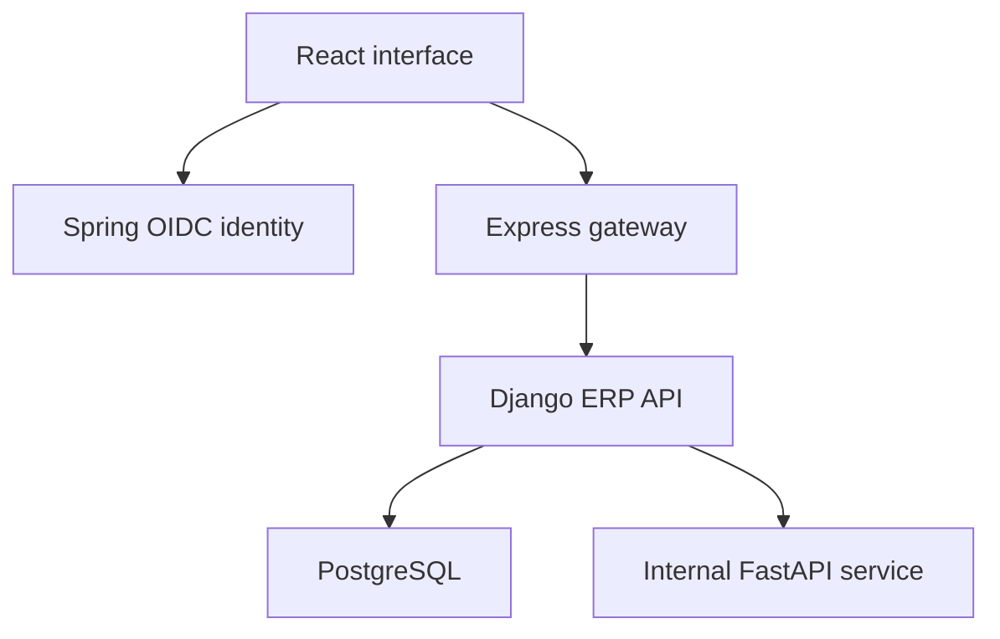

[StockPilot_Application_Reference.md](https://github.com/user-attachments/files/33464713/StockPilot_Application_Reference.md)
# StockPilot

**Inventory, purchasing, sales and finance in one multilingual workspace.**

StockPilot is an operational ERP application for organizations that need to track# StockPilot application reference

Updated 11 October 2026 for the correctness, performance and documentation revision.

Authoritative source: `StockPilot_GitHub_Ready.zip`; SHA-256 `f1a34b519d549997c18f5430ea76a988703b1776688345f85ba471bbec4300a3`.

This reference supersedes the original review snapshot. It preserves implementation locations and verification evidence for future work. Consult the saved source before editing; a reference document does not promise permanent conversational memory.

## Product and setup


**Inventory, purchasing, sales and finance in one multilingual workspace.**

StockPilot is an operational ERP application for organizations that need to track
products, warehouse stock, orders, invoices and payments. It combines a React
interface with a transactional Django API, a separate OIDC identity service,
and internal OCR and forecasting services.

The interface supports **English, French and Arabic**, including Arabic
right-to-left layout. Each organization has its own records, role assignments,
appearance settings and plugin installations.

## Features

| Module | Capabilities |
|---|---|
| Catalog | Products, categories, units, tax rates and customer/supplier records |
| Inventory | Stock balances, append-only movements, adjustments, transfers, reservations and reconciliation |
| Purchasing | Draft orders, submission, approval, partial receipts and event history |
| Sales | Stock reservation, partial shipment, cancellation and customer returns |
| Finance | Customer/supplier invoices, payment allocation, expenses and currency-separated summaries |
| Document OCR | Private PNG/JPEG/PDF uploads, extracted fields and human-reviewed supplier invoice drafts |
| Recommendations | Demand forecasts, replenishment suggestions, anomaly checks and recorded human decisions |
| Extensions | Reviewed JSON plugins, dependency validation, configuration, updates and rollback history |
| Workspace | Organization switching, role-based access, languages and optional design settings |

Financial reporting supports DZD, EUR and USD separately. OCR approval creates a
draft; it does not automatically post invoices. Recommendations do not
place orders. Plugins configure reviewed read-only behaviors rather than execute
uploaded third-party code.

## Architecture



| Component | Main technologies | Directory |
|---|---|---|
| Frontend | React, TypeScript, Vite, Material UI, React Query | `apps/web` |
| ERP API | Django, Django REST Framework, exact decimal arithmetic | `services/erp-core` |
| Gateway | Express, JWT verification, WebSocket notifications | `services/api-gateway` |
| Identity | Java 21, Spring Boot, Authorization Code + PKCE | `services/identity` |
| AI assistance | FastAPI, Tesseract, OpenCV, scikit-learn | `services/ai-service` |
| Developer SDK | Python manifest validator, CLI and API client | `sdk/python` |

The gateway handles transport; Django owns business rules and database writes.
Tenant-scoped API requests require an active membership and
`X-Organization-ID`. Both the gateway and ERP independently validate OIDC tokens.

## Quick start with Docker

Requirements: Docker Engine/Desktop with Compose. Windows users can use Docker
Desktop with WSL2. These commands start a local development environment.

```bash
cp .env.example .env
# Fresh, disposable demonstration only:
SEED_DEMO=true docker compose up --build
```

| Service | Local address |
|---|---|
| Application | http://localhost:5173 |
| Identity | http://localhost:9000 |
| API gateway | http://localhost:3000/api/v1 |

On a deliberately seeded demo, sign in using
`admin@stockpilot.local` / `Admin123!`. Use fictional data only.

For an existing installation, preserve configuration and backups, keep the same
Compose project name and volumes, and start with seeding disabled:

```bash
SEED_DEMO=false docker compose up --build
```

Do not use `docker compose down -v` when retaining data. Database records,
private uploaded documents and signing keys live in persistent volumes.
Migration filenames are retained for upgrade compatibility.

After changing accounts, passwords or roles, refresh the private identity snapshot:

```bash
docker compose run --rm identity-bootstrap
docker compose restart identity
```

## Local development

Requirements: Python 3.12 or 3.13, uv, Node.js 24, pnpm 11, Java 21 and Maven.
OCR additionally needs Tesseract with English/French language data and Poppler.

```bash
uv --project services/erp-core sync --frozen
uv --project services/ai-service sync --frozen
pnpm install --frozen-lockfile
npm --prefix services/api-gateway ci --ignore-scripts
```

For an isolated frontend/API development session, Django defaults to local JWT
authentication and SQLite. In separate terminals:

```bash
uv --project services/erp-core run python services/erp-core/manage.py migrate
uv --project services/erp-core run python services/erp-core/manage.py seed_finance_demo
uv --project services/erp-core run python services/erp-core/manage.py runserver
pnpm dev:web
```

The frontend defaults to `http://localhost:8000/api/v1` outside Compose.
An internal AI URL and matching `AI_SERVICE_TOKEN` are needed to run live OCR or
forecast requests. Use Docker for the integrated OIDC/gateway environment.

## Tests and verification

```bash
uv --project services/erp-core run pytest services/erp-core
uv --project services/erp-core run ruff check services/erp-core
uv --project services/erp-core run python services/erp-core/manage.py check
uv --project services/erp-core run python services/erp-core/manage.py makemigrations --check --dry-run
pnpm lint:web
pnpm test:web
pnpm build:web
npm --prefix services/api-gateway test
uv --project services/ai-service run pytest services/ai-service
mvn -B -f services/identity/pom.xml verify
```

See [verification evidence](docs/VERIFICATION.md) for actual results and remaining
checks. PostgreSQL is required for row-lock concurrency tests; SQLite does not
establish concurrent correctness. Strict mypy is configured but is not yet clean;
that debt is reported rather than suppressed.

## Extension development

```bash
python -m pip install ./sdk/python
stockpilot-plugin init my-stock-alert
stockpilot-plugin validate manifest.json
stockpilot-plugin build manifest.json --summary "Low-stock alert for our warehouses"
```

An organization administrator submits the package in Marketplace. A trusted
platform reviewer approves or rejects it before installation. Supported hooks:
`inventory.low_stock` and `dashboard.notice`. See
[Marketplace and SDK](docs/MARKETPLACE_AND_SDK.md) and
[plugin contracts](docs/PLUGIN_DEVELOPMENT.md).

## Project status and boundaries

This repository is a development application and portfolio demonstration.
Full deployment readiness depends on the target environment and verification.
Default Compose credentials and HTTP URLs are for localhost only.

- Forecasting uses a seven-day moving average; it does not model seasonality or open purchase orders.
- OCR supports English/French recognition; Arabic interface support does not imply Arabic OCR.
- Order-backed billing uses whole-order invoices, not partial-shipment invoicing.
- Finance summaries are operational reporting, not statutory accounting or a general ledger.
- Identity sessions and gateway rate limits are single-instance; scaling requires additional infrastructure.
- Coarse organization locks deliberately protect financial and inventory command consistency.
- Bundled manifests are cached immutable deployment assets; deploy a new release to change them.
- Notification hints use shared authenticated polling with an idle delay of up to 30 seconds, not durable event delivery.

## Documentation

- [Architecture and business rules](docs/ARCHITECTURE.md)
- [Languages and appearance](docs/LANGUAGE_AND_DESIGN.md)
- [Marketplace and SDK](docs/MARKETPLACE_AND_SDK.md)
- [Changes and verification](docs/REVISION_REVIEW.md)
- [Demonstration guide](docs/DEMO.md)
- [Contributing](CONTRIBUTING.md) and [security configuration](SECURITY.md)

No software license has been selected in this package. Choose a license before
advertising the repository as open source or granting reuse rights.


## Current implementation contracts


## Request boundaries

The React client selects an organization and attaches its ID to requests.
Express verifies access tokens, origin and request limits, then forwards a fixed
API prefix to Django. Django verifies the token again and checks current active
local membership. Data and business commands remain organization-scoped.

Spring issues five-minute RS256 access tokens through a public PKCE client.
Its account directory is a private exported snapshot. Role/password changes
require a refreshed export and identity restart; local revocations fail closed.

AI accepts a service token and is reachable internally. User uploads and human
approval are handled by Django. No browser receives the internal AI credential.

## Transaction contracts

- Inventory movements append history and update a locked balance together.
- Available stock is on-hand minus reserved; movements cannot consume reserved stock.
- Inventory retries compare persisted command contents; changed input conflicts.
- Purchase receipts cannot exceed remaining ordered quantity.
- Sales confirmation reserves all lines or none. Shipments consume reservations atomically.
- Cancellation preserves shipped history and releases the outstanding reservation.
- Customer returns restore stock but do not reopen fulfillment or create credit notes.
- Payments cannot exceed invoice balances or mix partners, directions or currencies.
- Plugin rollback restores extension state as a new revision; it does not undo ERP transactions.

Organization locks are intentionally retained to serialize commands and protect
idempotency under PostgreSQL. Narrower locks require measured contention and
concurrency regression coverage, not just a faster single-request benchmark.

## Performance choices

Feature screens use lazy imports. Translation lookup uses a precomputed map.
Finance summaries aggregate invoices, payments and expenses in three queries.
Purchase input resolves product lines in one tenant-scoped query. Plugin resolution
queries only the requested approved release; bundled manifests are cached and
returned as copies. Dependency traversal remembers visited nodes.

Anomaly detection caches only numeric demand results, bounded to 128 entries.
Margins and other request-specific values are evaluated freshly. This cache holds
no user identifiers or invoice rows and is not a shared application result cache.

Notification polling is shared only for a verified subject, organization and role.
It still rechecks membership through Django, adapts idle polling up to 30 seconds,
and retains per-connection expiry checks. Different users are not authorized
through one another's membership.

## Compatibility

Historical migration filenames/dependencies must not be renamed: existing
installations record those identities in the database. Deterministic demo UUID
namespaces also remain stable to avoid duplicating earlier demo records.
Descriptive seed commands are `seed_demo`, `seed_purchasing_demo`,
`seed_sales_demo` and `seed_finance_demo`.


## Revision and verification

# Correctness, performance and documentation review

Reviewed 11 October 2026. This revision preserves the existing application and
business workflows. Tests use synthetic records; no production database was accessed.

## Correctness changes

| Area | Problem | Result |
|---|---|---|
| Inventory authorization | Direct service callers could bypass API role checks | Adjustments, transfers, reservations and releases check an active tenant membership before accessing replayed commands |
| Inventory retries | A reused key could silently return a different previous request | Warehouse, reason, reference and normalized product/quantity/cost contents are compared; changed input returns HTTP 409 |
| Stock validation | Service entry points could accept invalid decimal or whole-unit quantities | Finite, bounded, nonzero quantities with up to four decimal places; units that disallow fractions require whole quantities |
| Purchasing | Inactive actors and fractional whole-unit order/receipt quantities needed stronger validation | Direct service calls enforce these rules as well as existing tenant and workflow checks |
| Notification load | Each socket independently polled the same history | Verified user/organization/role groups share polling, with independent token expiry and membership revocation handling |
| Demonstration records | User-facing order notes and invoice references carried tutorial labels | Descriptive values for new seeds; legacy order markers are renamed without duplicating drafts; existing invoice replay identities are preserved |

Inventory release callers now supply the actor explicitly. Existing callers in
API and sales workflows were updated. Historical migration identities and
stable demo UUID namespaces are retained for compatibility.

## Performance changes

| Operation | Change | Evidence or boundary |
|---|---|---|
| Finance summary | Three database aggregates replace repeated totals queries | Query-count regression checks the three-query contract; financial outcome tests still pass |
| Purchase inputs | Resolve all line products in one tenant-scoped query | Removes a query per input line; unit relationships are included |
| Plugin lookup | Cache immutable bundled manifests; query only the requested approved release | Caller mutation cannot alter the cache; selected community package integrity is still validated |
| Plugin dependencies | Remember already visited nodes | Avoids repeated traversal while retaining cycle detection |
| Translation lookup | Precompute normalized keys | Constant-time dictionary lookup replaces repeated key scans |
| Web bundle | Lazy-load feature screens and split vendor assets | Main index 347.85 kB / 113.84 kB gzip; UI vendor 299.57 kB / 92.78 kB gzip; feature chunks load separately |
| Notifications | Shared polling with idle backoff | Default activity interval 5 seconds; idle interval grows to 30 seconds; tests cover user isolation and revocation |
| Demand anomaly detection | Bounded cache of numeric statistical results | Maximum 128 entries; fresh margins are evaluated on every request |

These are structural improvements with regression coverage, not measured
production latency or throughput claims. The reported earlier monolithic bundle
was approximately 829 kB / 259 kB gzip; browser startup was not benchmarked.
Organization locks remain intentionally coarse to protect atomic workflows.

Forecasting still uses a seven-day moving average and Isolation Forest. This
revision improves repeated work, not forecast accuracy. No seasonal demand model
or replenishment optimization guarantee is claimed.

## Application text and GitHub presentation

The header, purchasing page and outdated billing message now describe actual
features. Seed commands and test module names are descriptive. Repeated tutorial
comments have been removed. README explains the product, architecture, setup,
features, extension development and boundaries. Architecture, security,
contribution and demonstration guides provide further context.

No GitHub repository was created or published. The archive contains source and
lockfiles, excludes local dependencies and credentials, and needs a license
choice before it is advertised as open source.

## Remaining work

Strict mypy still fails across the inherited backend. Its exact current count
and full output are in [verification](VERIFICATION.md) and [review/mypy.txt](review/mypy.txt).
The configuration has not been weakened to hide errors. A broad typing pass is
still necessary; this revision does not claim to have completed it.

PostgreSQL lock concurrency, Docker deployment, PostgreSQL backup/restore and
browser end-to-end behavior require their own environment verification. Live
Django-to-AI and Spring-to-gateway-to-Django integrations did pass. The complete
verification evidence distinguishes executed checks from pending ones.


# Verification evidence

Checks performed on 11 October 2026 against this revision. Full command outputs
are in [review/](review/); machine-readable results are in
[results.json](review/results.json).

| Check | Result |
|---|---|
| Django functional suite | 164 passed, 7 skipped; 2 warnings |
| Seed compatibility regression | 1 passed separately after descriptive seed changes |
| Live Django → FastAPI integration | 1 passed separately; OCR approval, invoice/payment and forecast flow |
| React/Vitest | 8 passed across 4 files |
| Gateway HTTP/WebSocket tests | 9 passed |
| FastAPI service | 11 passed, 2 upstream deprecation warnings; real image/PDF OCR exercised |
| Identity Maven verification with Java 21 | Build successful; 3 unit tests passed |
| Spring → gateway → Django integration | Passed: discovery, CSRF, PKCE, code replay rejection, JWT validation, tenant denial, writes and notifications |
| Existing identity schema upgrade | Passed; existing ERP rows preserved |
| Django system check | No issues |
| Migration drift | No changes detected |
| OpenAPI generation | Passed with warnings treated as failure |
| Ruff, backend and AI | Passed |
| ESLint and TypeScript/Vite build | Passed |
| Source syntax/configuration/relative imports | Passed |
| SDK CLI | Init, validate, build and refusal to overwrite existing files passed |
| Strict mypy | 564 errors in 63 files; complete output in mypy.txt |

## Skipped and unavailable checks

Six Django tests require PostgreSQL row locks: purchasing, sales, finance and
three inventory retry concurrency scenarios. The default SQLite test run skips
them. The seventh skip is opt-in live AI, which passed in a separate real-service
run. SQLite regression results do not prove PostgreSQL concurrency behavior.

Docker is unavailable in the review environment, so images and the full Compose
stack have not been built or run. PostgreSQL backup/restore has not been exercised.
Chromium installation failed, so no real browser end-to-end run, new screenshots
or demo video is included. Frontend tests use jsdom and the build compiles TypeScript.

## Reproduction

Run the commands in README from the repository root. To exercise PostgreSQL
concurrency, point DATABASE_URL at a dedicated disposable PostgreSQL database,
then run the Django suite. Do not use a production database.

For live AI, start the FastAPI service with Tesseract and Poppler installed.
Set the same AI_SERVICE_TOKEN on both services, set AI_SERVICE_URL on Django,
and run AI_INTEGRATION=1 with tests/test_ai_live.py.

For OIDC protocol integration, first build services/identity with Java 21 and
Maven, install gateway dependencies, then run:

```bash
uv --project services/erp-core run python scripts/test_identity_integration.py
```

That script uses disposable databases and starts real local services. It tests
protocol behavior, not a visual browser session or PostgreSQL locking.

## Performance evidence

Frontend feature screens are split into independent chunks. This build reports
347.85 kB / 113.84 kB gzip for the main index, plus a 299.57 kB / 92.78 kB gzip UI
vendor chunk. These sizes are not a browser latency measurement.

Regression tests verify the finance summary's three queries, selected plugin
resolution, immutable cached manifests, shared notification authorization and
fresh request-specific margin evaluation after a cached anomaly result.
No production load benchmark or forecast accuracy study has been performed.


## Release metadata

```json
{
  "application": "StockPilot",
  "release": "0.14.0",
  "plugin_api": 1,
  "gateway_service": "0.11.0",
  "identity_service": "0.11.0",
  "plugin_format": "reviewed declarative JSON manifests",
  "rollback_scope": "plugin release, enabled state and configuration",
  "revision": "correctness-performance-documentation",
  "languages": [
    "en",
    "fr",
    "ar"
  ],
  "sdk_version": "0.1.0"
}
```

## Source symbols and model fields

Line numbers refer to the revised source snapshot. Decorated symbols begin at their declaration line; review surrounding decorators before calling a service. Fields listed are declared assignments, not evaluated database schema.

### scripts/backup_restore_check.py

- `counts` — line 21
- `main` — line 33

### scripts/test_identity_integration.py

- `NoRedirect` — line 36
- `NoRedirect.redirect_request` — line 37
- `port` — line 41
- `main` — line 47

### scripts/verify_static.py

- `main` — line 13

### sdk/python/stockpilot_sdk.py

- `scaffold` — line 14
- `NoRedirect` — line 20
- `NoRedirect.redirect_request` — line 21
- `Client` — line 26
- `Client.__init__` — line 27
- `Client.request` — line 35
- `Client.catalog` — line 45
- `Client.submit` — line 48
- `Client.command` — line 51
- `main` — line 57

### sdk/python/stockpilot_validation.py

- `version` — line 11
- `checksum` — line 17
- `validate` — line 21
- `configuration` — line 59

### services/ai-service/app/forecast.py

- `MarginRow` — line 14
- `ForecastInput` — line 22
- `demand_anomalies` — line 35
- `analyze` — line 43

### services/ai-service/app/main.py

- `authenticate` — line 15
- `health` — line 22
- `ocr` — line 27
- `forecast` — line 45

### services/ai-service/app/ocr.py

- `image_pixels` — line 19
- `extract_document` — line 27

### services/ai-service/tests/test_ai.py

- `data` — line 13
- `test_constant_demand_and_reorder_math` — line 26
- `test_zero_demand_has_undefined_wape` — line 34
- `test_holdout_does_not_leak_future_values` — line 39
- `test_margin_rules_and_reproducibility` — line 46
- `test_token_and_request_validation` — line 59
- `test_missing_token_fails_closed` — line 85
- `test_real_ocr_pixels` — line 93
- `test_invalid_file_rejected` — line 114
- `test_pdf_page_limit_before_rendering` — line 119
- `test_cached_anomaly_results_preserve_fresh_margin_evaluation` — line 131

### services/erp-core/apps/audit/api.py

- `AuditOutput` — line 9
- `AuditOutput.Meta` — line 10
- `AuditViewSet` — line 15

### services/erp-core/apps/audit/apps.py

- `AuditConfig` — line 4
- `AuditConfig.ready` — line 7

### services/erp-core/apps/audit/models.py

- `AppendOnlyQuerySet` — line 9
- `AppendOnlyQuerySet.update` — line 10
- `AppendOnlyQuerySet.delete` — line 13
- `AppendOnlyQuerySet.bulk_update` — line 16
- `AuditEvent` — line 20
  - `action = models.CharField(max_length=80)`
  - `entity_type = models.CharField(max_length=80)`
  - `entity_id = models.UUIDField()`
  - `detail = models.JSONField(default=dict)`
  - `objects = AppendOnlyQuerySet.as_manager()`
- `AuditEvent.Meta` — line 27
  - `ordering = ['-created_at', '-id']`
  - `indexes = [models.Index(fields=['organization', '-created_at', '-id'], name='audit_org_recent_idx')]`
- `AuditEvent.save` — line 33
- `AuditEvent.delete` — line 38

### services/erp-core/apps/audit/services.py

- `record` — line 4

### services/erp-core/apps/audit/signals.py

- `mirror_business_event` — line 13
- `mirror_movement` — line 26

### services/erp-core/apps/billing/api.py

- `LineInput` — line 13
- `DraftInput` — line 26
- `AllocationInput` — line 38
- `PaymentInput` — line 43
- `LineOutput` — line 50
- `LineOutput.Meta` — line 51
- `InvoiceOutput` — line 66
- `InvoiceOutput.get_balance` — line 71
- `InvoiceOutput.Meta` — line 74
- `AllocationOutput` — line 99
- `AllocationOutput.Meta` — line 100
- `PaymentOutput` — line 105
- `PaymentOutput.Meta` — line 108
- `InvoiceViewSet` — line 122
- `InvoiceViewSet.create` — line 127
- `InvoiceViewSet.post` — line 133
- `InvoiceViewSet.void` — line 140
- `PaymentViewSet` — line 148
- `PaymentViewSet.create` — line 153

### services/erp-core/apps/billing/models.py

- `Invoice` — line 9
  - `partner = models.ForeignKey('partners.BusinessPartner', on_delete=models.PROTECT)`
  - `kind = models.CharField(max_length=16, choices=Kind.choices)`
  - `reference = models.CharField(max_length=64)`
  - `currency = models.CharField(max_length=3, default='DZD')`
  - `issued_on = models.DateField()`
  - `due_on = models.DateField()`
  - `status = models.CharField(max_length=8, choices=Status.choices, default=Status.DRAFT)`
  - `sales_order = models.OneToOneField('sales.SalesOrder', on_delete=models.PROTECT, null=True)`
  - `purchase_order = models.OneToOneField('purchasing.PurchaseOrder', on_delete=models.PROTECT, null=True)`
  - `subtotal = models.DecimalField(max_digits=18, decimal_places=2, default=0)`
  - `tax_total = models.DecimalField(max_digits=18, decimal_places=2, default=0)`
  - `total = models.DecimalField(max_digits=18, decimal_places=2, default=0)`
  - `paid = models.DecimalField(max_digits=18, decimal_places=2, default=0)`
  - `cost_total = models.DecimalField(max_digits=18, decimal_places=2, default=0)`
  - `idempotency_key = models.UUIDField()`
  - `payload_hash = models.CharField(max_length=64)`
- `Invoice.Kind` — line 10
  - `CUSTOMER = ('CUSTOMER', 'Customer receivable')`
  - `SUPPLIER = ('SUPPLIER', 'Supplier payable')`
- `Invoice.Status` — line 14
  - `DRAFT = ('DRAFT', 'Draft')`
  - `POSTED = ('POSTED', 'Posted')`
  - `VOID = ('VOID', 'Voided')`
- `Invoice.Meta` — line 39
  - `ordering = ['-created_at']`
  - `constraints = [models.UniqueConstraint(fields=['organization', 'idempotency_key'], name='invoice_key'), models.UniqueConstraint(fields=['organization', 'kind', 'partner', 'reference'], name='invoice_reference'), models.CheckConstraint(condition=Q(paid__gte=0, paid__lte=F('total')), name='invoice_paid_bounds'), models.CheckConstraint(condition=Q(total__gte=0), name='invoice_total_nonnegative'), models.CheckConstraint(condition=Q(due_on__gte=F('issued_on')), name='invoice_due_date')]`
- `InvoiceLine` — line 56
  - `invoice = models.ForeignKey(Invoice, on_delete=models.PROTECT, related_name='lines')`
  - `product = models.ForeignKey('catalog.Product', on_delete=models.PROTECT, null=True)`
  - `description = models.CharField(max_length=240)`
  - `quantity = models.DecimalField(max_digits=18, decimal_places=4)`
  - `unit_price = models.DecimalField(max_digits=18, decimal_places=4)`
  - `unit_cost = models.DecimalField(max_digits=18, decimal_places=4, default=0)`
  - `tax_rate = models.DecimalField(max_digits=5, decimal_places=2, default=0)`
  - `net = models.DecimalField(max_digits=18, decimal_places=2)`
  - `tax = models.DecimalField(max_digits=18, decimal_places=2)`
- `InvoiceLine.Meta` — line 67
  - `constraints = [models.CheckConstraint(condition=Q(quantity__gt=0), name='invoice_line_qty'), models.CheckConstraint(condition=Q(unit_price__gte=0, unit_cost__gte=0), name='invoice_line_prices'), models.CheckConstraint(condition=Q(tax_rate__gte=0, tax_rate__lte=100), name='invoice_line_tax')]`
- `Payment` — line 79
  - `partner = models.ForeignKey('partners.BusinessPartner', on_delete=models.PROTECT)`
  - `kind = models.CharField(max_length=16, choices=Invoice.Kind.choices)`
  - `currency = models.CharField(max_length=3)`
  - `amount = models.DecimalField(max_digits=18, decimal_places=2)`
  - `paid_on = models.DateField()`
  - `reference = models.CharField(max_length=120)`
  - `idempotency_key = models.UUIDField()`
  - `payload_hash = models.CharField(max_length=64)`
- `Payment.Meta` — line 90
  - `ordering = ['-created_at']`
  - `constraints = [models.UniqueConstraint(fields=['organization', 'idempotency_key'], name='payment_key'), models.CheckConstraint(condition=Q(amount__gt=0), name='payment_positive')]`
- `PaymentAllocation` — line 98
  - `payment = models.ForeignKey(Payment, on_delete=models.PROTECT, related_name='allocations')`
  - `invoice = models.ForeignKey(Invoice, on_delete=models.PROTECT, related_name='allocations')`
  - `amount = models.DecimalField(max_digits=18, decimal_places=2)`
- `PaymentAllocation.Meta` — line 103
  - `constraints = [models.UniqueConstraint(fields=['payment', 'invoice'], name='allocation_once'), models.CheckConstraint(condition=Q(amount__gt=0), name='allocation_positive')]`

### services/erp-core/apps/billing/services.py

- `create_invoice` — line 28
- `change_status` — line 173
- `allocate_payment` — line 196

### services/erp-core/apps/catalog/api/serializers.py

- `CategorySerializer` — line 7
- `CategorySerializer.Meta` — line 8
- `UnitOfMeasureSerializer` — line 14
- `UnitOfMeasureSerializer.Meta` — line 15
- `TaxRateSerializer` — line 21
- `TaxRateSerializer.Meta` — line 22
- `ProductSerializer` — line 28
- `ProductSerializer.Meta` — line 37
- `ProductSerializer.validate` — line 60

### services/erp-core/apps/catalog/api/views.py

- `CategoryViewSet` — line 12
- `UnitOfMeasureViewSet` — line 17
- `TaxRateViewSet` — line 22
- `ProductViewSet` — line 27

### services/erp-core/apps/catalog/apps.py

- `CatalogConfig` — line 5

### services/erp-core/apps/catalog/models.py

- `Category` — line 11
  - `code = models.CharField(max_length=40)`
  - `name = models.CharField(max_length=120)`
  - `description = models.TextField(blank=True)`
  - `is_active = models.BooleanField(default=True)`
- `Category.Meta` — line 16
  - `ordering = ['name']`
  - `constraints = [models.UniqueConstraint(fields=['organization', 'code'], name='unique_category_code_per_organization')]`
- `Category.__str__` — line 26
- `UnitOfMeasure` — line 30
  - `name = models.CharField(max_length=80)`
  - `symbol = models.CharField(max_length=16)`
  - `allows_decimals = models.BooleanField(default=True)`
- `UnitOfMeasure.Meta` — line 34
  - `ordering = ['name']`
  - `constraints = [models.UniqueConstraint(fields=['organization', 'symbol'], name='unique_unit_symbol_per_organization')]`
- `UnitOfMeasure.__str__` — line 44
- `TaxRate` — line 48
  - `name = models.CharField(max_length=80)`
  - `rate = models.DecimalField(max_digits=5, decimal_places=2, validators=[MinValueValidator(Decimal('0.00'))], help_text='Percentage, for example 19.00 means 19%.')`
  - `is_active = models.BooleanField(default=True)`
- `TaxRate.Meta` — line 57
  - `ordering = ['rate', 'name']`
  - `constraints = [models.UniqueConstraint(fields=['organization', 'name'], name='unique_tax_name_per_organization')]`
- `TaxRate.__str__` — line 67
- `Product` — line 71
  - `sku = models.CharField(max_length=64)`
  - `name = models.CharField(max_length=180)`
  - `description = models.TextField(blank=True)`
  - `category = models.ForeignKey(Category, on_delete=models.PROTECT, related_name='products', null=True, blank=True)`
  - `unit = models.ForeignKey(UnitOfMeasure, on_delete=models.PROTECT, related_name='products')`
  - `tax_rate = models.ForeignKey(TaxRate, on_delete=models.PROTECT, related_name='products', null=True, blank=True)`
  - `purchase_price = models.DecimalField(max_digits=18, decimal_places=4, default=Decimal('0.0000'), validators=[MinValueValidator(Decimal('0'))])`
  - `selling_price = models.DecimalField(max_digits=18, decimal_places=4, default=Decimal('0.0000'), validators=[MinValueValidator(Decimal('0'))])`
  - `minimum_stock = models.DecimalField(max_digits=18, decimal_places=4, default=Decimal('0.0000'), validators=[MinValueValidator(Decimal('0'))])`
  - `is_active = models.BooleanField(default=True)`
- `Product.Meta` — line 109
  - `ordering = ['name']`
  - `constraints = [models.UniqueConstraint(fields=['organization', 'sku'], name='unique_product_sku_per_organization')]`
- `Product.clean` — line 119
- `Product.__str__` — line 134

### services/erp-core/apps/catalog/selectors.py

- `products_for_organization` — line 5
- `categories_for_organization` — line 13
- `units_for_organization` — line 17
- `tax_rates_for_organization` — line 21

### services/erp-core/apps/catalog/services.py

- `create_product` — line 10

### services/erp-core/apps/common/api.py

- `TenantReadViewSet` — line 11
- `TenantReadViewSet.get_queryset` — line 15
- `TenantReadViewSet.command_args` — line 20
- `TenantReadViewSet.validate` — line 26
- `EmptyInput` — line 32
- `ReasonInput` — line 36
- `CurrencyInput` — line 40

### services/erp-core/apps/common/apps.py

- `CommonConfig` — line 5

### services/erp-core/apps/common/commands.py

- `Conflict` — line 15
- `authorize` — line 20
- `lock_organization` — line 35
- `number` — line 40
- `money` — line 54
- `digest` — line 59
- `replay` — line 63

### services/erp-core/apps/common/exceptions.py

- `stockpilot_exception_handler` — line 6

### services/erp-core/apps/common/models.py

- `TimeStampedUUIDModel` — line 8
  - `id = models.UUIDField(primary_key=True, default=uuid.uuid4, editable=False)`
  - `created_at = models.DateTimeField(auto_now_add=True)`
  - `updated_at = models.DateTimeField(auto_now=True)`
- `TimeStampedUUIDModel.Meta` — line 13
  - `abstract = True`
- `OrganizationScopedQuerySet` — line 17
- `OrganizationScopedQuerySet.for_organization` — line 19
- `OrganizationScopedModel` — line 23
  - `organization = models.ForeignKey('tenancy.Organization', on_delete=models.PROTECT, related_name='%(app_label)s_%(class)s_records')`
  - `created_by = models.ForeignKey(settings.AUTH_USER_MODEL, on_delete=models.PROTECT, related_name='created_%(app_label)s_%(class)s_records', null=True, blank=True)`
  - `objects = OrganizationScopedQuerySet.as_manager()`
- `OrganizationScopedModel.Meta` — line 39
  - `abstract = True`

### services/erp-core/apps/common/notifications.py

- `NotificationSerializer` — line 11
- `NotificationRevisionView` — line 15
- `NotificationRevisionView.get` — line 17

### services/erp-core/apps/common/permissions.py

- `TenantRolePermission` — line 10
- `TenantRolePermission.has_permission` — line 16

### services/erp-core/apps/common/views.py

- `HealthView` — line 9
- `HealthView.get` — line 21

### services/erp-core/apps/common/viewsets.py

- `OrganizationScopedModelViewSet` — line 12
- `OrganizationScopedModelViewSet.get_membership` — line 18
- `OrganizationScopedModelViewSet.get_queryset` — line 22
- `OrganizationScopedModelViewSet.perform_create` — line 29
- `OrganizationScopedModelViewSet.perform_update` — line 37
- `OrganizationScopedModelViewSet.perform_destroy` — line 44

### services/erp-core/apps/extensions/api.py

- `CommandSerializer` — line 18
- `CommandSerializer.validate` — line 29
- `InstallationSerializer` — line 44
- `InstallationSerializer.Meta` — line 45
- `RevisionSerializer` — line 50
- `RevisionSerializer.Meta` — line 51
- `PluginList` — line 56
- `PluginList.get` — line 58
- `PluginCommand` — line 71
- `PluginCommand.post` — line 73
- `PluginHistory` — line 83
- `PluginHistory.get` — line 85
- `PluginInsights` — line 94
- `PluginInsights.get` — line 96

### services/erp-core/apps/extensions/appearance.py

- `TokensSerializer` — line 28
- `SaveSerializer` — line 38
- `AppearanceView` — line 43
- `AppearanceView.get` — line 45
- `AppearanceView.put` — line 58

### services/erp-core/apps/extensions/apps.py

- `ExtensionsConfig` — line 4

### services/erp-core/apps/extensions/hooks.py

- `execute` — line 8

### services/erp-core/apps/extensions/marketplace.py

- `administrator` — line 20
- `SubmissionSerializer` — line 27
- `SubmissionSerializer.validate_manifest` — line 31
- `ReleaseSerializer` — line 35
- `ReleaseSerializer.Meta` — line 36
- `ReviewSerializer` — line 51
- `Marketplace` — line 56
- `Marketplace.get` — line 58
- `Submissions` — line 96
- `Submissions.get` — line 98
- `Submissions.post` — line 107
- `Review` — line 136
- `Review.post` — line 139

### services/erp-core/apps/extensions/models.py

- `Installation` — line 9
  - `slug = models.SlugField(max_length=64)`
  - `release = models.JSONField()`
  - `checksum = models.CharField(max_length=64)`
  - `configuration = models.JSONField(default=dict)`
  - `enabled = models.BooleanField(default=True)`
  - `revision = models.PositiveIntegerField(default=1)`
- `Installation.Meta` — line 17
  - `constraints = [models.UniqueConstraint(fields=['organization', 'slug'], name='extension_org_slug_unique')]`
- `MarketplaceRelease` — line 25
  - `slug = models.SlugField(max_length=64)`
  - `version = models.CharField(max_length=20)`
  - `manifest = models.JSONField()`
  - `checksum = models.CharField(max_length=64)`
  - `summary = models.CharField(max_length=240)`
  - `status = models.CharField(max_length=16, default='pending', choices=[('pending', 'Pending'), ('approved', 'Approved'), ('rejected', 'Rejected')])`
  - `review_note = models.CharField(max_length=500, blank=True)`
  - `reviewed_by = models.ForeignKey('tenancy.User', null=True, on_delete=models.PROTECT, related_name='reviewed_plugins')`
- `MarketplaceRelease.Meta` — line 43
  - `constraints = [models.UniqueConstraint(fields=['slug', 'version'], name='marketplace_release_unique')]`
- `Appearance` — line 49
  - `settings = models.JSONField(default=dict)`
  - `revision = models.PositiveIntegerField(default=1)`
- `Appearance.Meta` — line 53
  - `constraints = [models.UniqueConstraint(fields=['organization'], name='appearance_org_unique')]`
- `Revision` — line 59
  - `objects = AppendOnlyQuerySet.as_manager()`
  - `installation = models.ForeignKey(Installation, on_delete=models.PROTECT, related_name='history')`
  - `number = models.PositiveIntegerField()`
  - `operation = models.CharField(max_length=16)`
  - `snapshot = models.JSONField()`
  - `idempotency_key = models.UUIDField()`
  - `payload_hash = models.CharField(max_length=64)`
- `Revision.Meta` — line 68
  - `ordering = ['-number']`
  - `constraints = [models.UniqueConstraint(fields=['installation', 'number'], name='extension_revision_unique'), models.UniqueConstraint(fields=['organization', 'idempotency_key'], name='extension_key_unique')]`
- `Revision.save` — line 79
- `Revision.delete` — line 84

### services/erp-core/apps/extensions/registry.py

- `version` — line 20
- `checksum` — line 26
- `validate` — line 30
- `configuration` — line 77
- `bundled_releases` — line 88
- `_bundled_releases` — line 94
- `releases` — line 107
- `resolve` — line 119

### services/erp-core/apps/extensions/services.py

- `snapshot` — line 16
- `dependencies` — line 25
- `change` — line 58

### services/erp-core/apps/finance/api.py

- `ExpenseInput` — line 17
- `ExpenseOutput` — line 25
- `ExpenseOutput.Meta` — line 26
- `ExpenseViewSet` — line 31
- `ExpenseViewSet.create` — line 36
- `ExpenseViewSet.void` — line 42
- `SummaryView` — line 50
- `SummaryView.get` — line 76

### services/erp-core/apps/finance/management/commands/seed_finance_demo.py

- `Command` — line 18
- `Command.handle` — line 22

### services/erp-core/apps/finance/models.py

- `Expense` — line 7
  - `description = models.CharField(max_length=240)`
  - `category = models.CharField(max_length=80)`
  - `amount = models.DecimalField(max_digits=18, decimal_places=2)`
  - `currency = models.CharField(max_length=3)`
  - `spent_on = models.DateField()`
  - `is_void = models.BooleanField(default=False)`
  - `idempotency_key = models.UUIDField()`
  - `payload_hash = models.CharField(max_length=64)`
- `Expense.Meta` — line 18
  - `ordering = ['-spent_on', '-created_at']`
  - `constraints = [models.UniqueConstraint(fields=['organization', 'idempotency_key'], name='expense_key'), models.CheckConstraint(condition=Q(amount__gt=0), name='expense_positive')]`

### services/erp-core/apps/finance/selectors.py

- `summary` — line 14

### services/erp-core/apps/finance/services.py

- `create_expense` — line 11
- `void_expense` — line 42

### services/erp-core/apps/intelligence/api.py

- `UploadInput` — line 17
- `ReviewInput` — line 21
- `OCROutput` — line 29
- `OCROutput.Meta` — line 30
- `ForecastInput` — line 46
- `DecisionInput` — line 53
- `RunOutput` — line 58
- `RunOutput.Meta` — line 62
- `OCRViewSet` — line 82
- `OCRViewSet.upload` — line 89
- `OCRViewSet.extract` — line 95
- `OCRViewSet.approve` — line 102
- `OCRViewSet.download` — line 111
- `ForecastViewSet` — line 124
- `ForecastViewSet.create` — line 130
- `ForecastViewSet.decide` — line 136

### services/erp-core/apps/intelligence/client.py

- `AIUnavailable` — line 11
- `call_ai` — line 18

### services/erp-core/apps/intelligence/models.py

- `private_document_path` — line 8
- `OCRDocument` — line 13
  - `file = models.FileField(upload_to=private_document_path)`
  - `original_name = models.CharField(max_length=240)`
  - `sha256 = models.CharField(max_length=64)`
  - `status = models.CharField(max_length=16, default='UPLOADED', choices=[(s, s.title()) for s in ['UPLOADED', 'PROCESSING', 'REVIEW', 'FAILED', 'APPROVED']])`
  - `extraction = models.JSONField(default=dict)`
  - `correction = models.JSONField(default=dict)`
  - `error = models.CharField(max_length=240, blank=True)`
  - `attempt = models.UUIDField(null=True)`
  - `invoice = models.OneToOneField('billing.Invoice', on_delete=models.PROTECT, null=True)`
  - `approval_hash = models.CharField(max_length=64, blank=True)`
- `OCRDocument.Meta` — line 32
  - `ordering = ['-created_at']`
- `RecommendationRun` — line 36
  - `product = models.ForeignKey('catalog.Product', on_delete=models.PROTECT)`
  - `warehouse = models.ForeignKey('inventory.Warehouse', on_delete=models.PROTECT)`
  - `inputs = models.JSONField()`
  - `result = models.JSONField(default=dict)`
  - `status = models.CharField(max_length=16, default='RUNNING')`
  - `error = models.CharField(max_length=240, blank=True)`
  - `decision = models.CharField(max_length=16, default='PENDING', choices=[(s, s.title()) for s in ['PENDING', 'ACCEPTED', 'REJECTED']])`
  - `decision_note = models.TextField(blank=True)`
  - `decided_by = models.ForeignKey('tenancy.User', on_delete=models.PROTECT, null=True, related_name='ai_decisions')`
  - `decided_at = models.DateTimeField(null=True)`
- `RecommendationRun.Meta` — line 55
  - `ordering = ['-created_at']`

### services/erp-core/apps/intelligence/services.py

- `upload_document` — line 33
- `extract` — line 61
- `approve_document` — line 113
- `run_forecast` — line 143
- `decide` — line 235

### services/erp-core/apps/inventory/admin.py

- `ReadOnlyInventoryAdmin` — line 18
- `ReadOnlyInventoryAdmin.has_view_permission` — line 21
- `ReadOnlyInventoryAdmin.has_add_permission` — line 25
- `ReadOnlyInventoryAdmin.has_change_permission` — line 29
- `ReadOnlyInventoryAdmin.has_delete_permission` — line 33
- `StockMovementAdmin` — line 50
- `StockBalanceAdmin` — line 64

### services/erp-core/apps/inventory/api/serializers.py

- `WarehouseSerializer` — line 19
- `WarehouseSerializer.Meta` — line 20
- `StockMovementSerializer` — line 26
- `StockMovementSerializer.Meta` — line 36
- `StockBalanceSerializer` — line 58
- `StockBalanceSerializer.Meta` — line 65
- `AdjustmentLineInputSerializer` — line 83
- `StockAdjustmentWriteSerializer` — line 94
- `StockAdjustmentWriteSerializer.validate` — line 102
- `StockAdjustmentLineSerializer` — line 124
- `StockAdjustmentLineSerializer.Meta` — line 127
- `StockAdjustmentSerializer` — line 139
- `StockAdjustmentSerializer.Meta` — line 142
- `TransferLineInputSerializer` — line 156
- `StockTransferWriteSerializer` — line 171
- `StockTransferWriteSerializer.validate` — line 180
- `StockTransferLineSerializer` — line 208
- `StockTransferLineSerializer.Meta` — line 211
- `StockTransferSerializer` — line 216
- `StockTransferSerializer.Meta` — line 226
- `StockReservationWriteSerializer` — line 242
- `StockReservationWriteSerializer.validate_source_type` — line 254
- `StockReservationWriteSerializer.validate` — line 261
- `StockReservationSerializer` — line 271
- `StockReservationSerializer.Meta` — line 275
- `ReconciliationItemSerializer` — line 295
- `ReconciliationReportSerializer` — line 303

### services/erp-core/apps/inventory/api/views.py

- `WarehouseViewSet` — line 43
- `OrganizationScopedReadOnlyViewSet` — line 53
- `OrganizationScopedReadOnlyViewSet.get_queryset` — line 57
- `StockMovementViewSet` — line 64
- `StockMovementViewSet.get_queryset` — line 69
- `StockBalanceViewSet` — line 80
- `StockAdjustmentViewSet` — line 85
- `StockAdjustmentViewSet.get_serializer_class` — line 97
- `StockAdjustmentViewSet.create` — line 111
- `StockTransferViewSet` — line 130
- `StockTransferViewSet.get_serializer_class` — line 143
- `StockTransferViewSet.create` — line 157
- `StockReservationViewSet` — line 176
- `StockReservationViewSet.get_serializer_class` — line 187
- `StockReservationViewSet.create` — line 201
- `StockReservationViewSet.release` — line 221
- `ReconciliationView` — line 231
- `ReconciliationView.get` — line 235

### services/erp-core/apps/inventory/apps.py

- `InventoryConfig` — line 5

### services/erp-core/apps/inventory/fulfilment.py

- `consume_sales_reservation` — line 19
- `post_customer_return` — line 66

### services/erp-core/apps/inventory/models.py

- `Warehouse` — line 16
  - `code = models.CharField(max_length=40)`
  - `name = models.CharField(max_length=120)`
  - `address = models.TextField(blank=True)`
  - `is_active = models.BooleanField(default=True)`
- `Warehouse.Meta` — line 21
  - `ordering = ['name']`
  - `constraints = [models.UniqueConstraint(fields=['organization', 'code'], name='unique_warehouse_code_per_organization')]`
- `Warehouse.__str__` — line 31
- `StockAdjustment` — line 35
  - `reference = models.CharField(max_length=64)`
  - `warehouse = models.ForeignKey(Warehouse, on_delete=models.PROTECT, related_name='stock_adjustments')`
  - `reason = models.TextField()`
  - `idempotency_key = models.UUIDField()`
  - `posted_at = models.DateTimeField(default=timezone.now)`
- `StockAdjustment.Meta` — line 45
  - `ordering = ['-posted_at']`
  - `constraints = [models.UniqueConstraint(fields=['organization', 'reference'], name='unique_adjustment_reference_per_organization'), models.UniqueConstraint(fields=['organization', 'idempotency_key'], name='unique_adjustment_idempotency_per_organization')]`
- `StockAdjustment.__str__` — line 59
- `StockAdjustmentLine` — line 63
  - `adjustment = models.ForeignKey(StockAdjustment, on_delete=models.PROTECT, related_name='lines')`
  - `product = models.ForeignKey('catalog.Product', on_delete=models.PROTECT, related_name='stock_adjustment_lines')`
  - `quantity_signed = models.DecimalField(max_digits=18, decimal_places=4)`
  - `unit_cost = models.DecimalField(max_digits=18, decimal_places=4, default=Decimal('0.0000'), validators=[MinValueValidator(Decimal('0'))])`
- `StockAdjustmentLine.Meta` — line 81
  - `ordering = ['created_at']`
  - `constraints = [models.UniqueConstraint(fields=['adjustment', 'product'], name='one_adjustment_line_per_product'), models.CheckConstraint(condition=~Q(quantity_signed=0), name='adjustment_quantity_is_not_zero'), models.CheckConstraint(condition=Q(unit_cost__gte=0), name='adjustment_unit_cost_not_negative')]`
- `StockTransfer` — line 99
  - `reference = models.CharField(max_length=64)`
  - `source_warehouse = models.ForeignKey(Warehouse, on_delete=models.PROTECT, related_name='outgoing_stock_transfers')`
  - `destination_warehouse = models.ForeignKey(Warehouse, on_delete=models.PROTECT, related_name='incoming_stock_transfers')`
  - `reason = models.TextField(blank=True)`
  - `idempotency_key = models.UUIDField()`
  - `transferred_at = models.DateTimeField(default=timezone.now)`
- `StockTransfer.Meta` — line 114
  - `ordering = ['-transferred_at']`
  - `constraints = [models.UniqueConstraint(fields=['organization', 'reference'], name='unique_transfer_reference_per_organization'), models.UniqueConstraint(fields=['organization', 'idempotency_key'], name='unique_transfer_idempotency_per_organization'), models.CheckConstraint(condition=~Q(source_warehouse=F('destination_warehouse')), name='transfer_warehouses_are_different')]`
- `StockTransfer.__str__` — line 132
- `StockTransferLine` — line 136
  - `transfer = models.ForeignKey(StockTransfer, on_delete=models.PROTECT, related_name='lines')`
  - `product = models.ForeignKey('catalog.Product', on_delete=models.PROTECT, related_name='stock_transfer_lines')`
  - `quantity = models.DecimalField(max_digits=18, decimal_places=4, validators=[MinValueValidator(Decimal('0.0001'))])`
  - `unit_cost = models.DecimalField(max_digits=18, decimal_places=4, default=Decimal('0.0000'), validators=[MinValueValidator(Decimal('0'))])`
- `StockTransferLine.Meta` — line 158
  - `ordering = ['created_at']`
  - `constraints = [models.UniqueConstraint(fields=['transfer', 'product'], name='one_transfer_line_per_product'), models.CheckConstraint(condition=Q(quantity__gt=0), name='transfer_quantity_is_positive'), models.CheckConstraint(condition=Q(unit_cost__gte=0), name='transfer_unit_cost_not_negative')]`
- `ImmutableStockMovementQuerySet` — line 176
- `ImmutableStockMovementQuerySet.update` — line 178
- `ImmutableStockMovementQuerySet.delete` — line 182
- `StockMovement` — line 186
  - `product = models.ForeignKey('catalog.Product', on_delete=models.PROTECT, related_name='stock_movements')`
  - `warehouse = models.ForeignKey(Warehouse, on_delete=models.PROTECT, related_name='stock_movements')`
  - `movement_type = models.CharField(max_length=32, choices=MovementType.choices)`
  - `quantity_signed = models.DecimalField(max_digits=18, decimal_places=4)`
  - `unit_cost = models.DecimalField(max_digits=18, decimal_places=4, default=Decimal('0.0000'), validators=[MinValueValidator(Decimal('0'))])`
  - `occurred_at = models.DateTimeField(default=timezone.now)`
  - `source_type = models.CharField(max_length=32, choices=SourceType.choices)`
  - `source_id = models.UUIDField()`
  - `idempotency_key = models.UUIDField(unique=True)`
  - `objects = ImmutableStockMovementQuerySet.as_manager()`
- `StockMovement.MovementType` — line 187
  - `OPENING = ('OPENING', 'Opening balance')`
  - `PURCHASE_RECEIPT = ('PURCHASE_RECEIPT', 'Purchase receipt')`
  - `SALE_SHIPMENT = ('SALE_SHIPMENT', 'Sale shipment')`
  - `CUSTOMER_RETURN = ('CUSTOMER_RETURN', 'Customer return')`
  - `SUPPLIER_RETURN = ('SUPPLIER_RETURN', 'Supplier return')`
  - `ADJUSTMENT_IN = ('ADJUSTMENT_IN', 'Adjustment in')`
  - `ADJUSTMENT_OUT = ('ADJUSTMENT_OUT', 'Adjustment out')`
  - `TRANSFER_IN = ('TRANSFER_IN', 'Transfer in')`
  - `TRANSFER_OUT = ('TRANSFER_OUT', 'Transfer out')`
- `StockMovement.SourceType` — line 198
  - `STOCK_ADJUSTMENT = ('STOCK_ADJUSTMENT', 'Stock adjustment')`
  - `STOCK_TRANSFER = ('STOCK_TRANSFER', 'Stock transfer')`
  - `PURCHASE_RECEIPT = ('PURCHASE_RECEIPT', 'Purchase receipt')`
  - `SHIPMENT = ('SHIPMENT', 'Shipment')`
  - `CUSTOMER_RETURN = ('CUSTOMER_RETURN', 'Customer return')`
  - `SUPPLIER_RETURN = ('SUPPLIER_RETURN', 'Supplier return')`
- `StockMovement.Meta` — line 229
  - `ordering = ['-occurred_at', '-created_at']`
  - `constraints = [models.CheckConstraint(condition=~Q(quantity_signed=0), name='stock_movement_quantity_is_not_zero'), models.CheckConstraint(condition=Q(unit_cost__gte=0), name='movement_unit_cost_not_negative')]`
  - `indexes = [models.Index(fields=['organization', 'product', 'warehouse', 'occurred_at'], name='movement_stock_history_idx'), models.Index(fields=['organization', 'source_type', 'source_id'], name='movement_source_idx')]`
- `StockMovement.save` — line 253
- `StockMovement.delete` — line 259
- `StockBalance` — line 263
  - `product = models.ForeignKey('catalog.Product', on_delete=models.PROTECT, related_name='stock_balances')`
  - `warehouse = models.ForeignKey(Warehouse, on_delete=models.PROTECT, related_name='stock_balances')`
  - `on_hand = models.DecimalField(max_digits=18, decimal_places=4, default=Decimal('0'))`
  - `reserved = models.DecimalField(max_digits=18, decimal_places=4, default=Decimal('0'))`
- `StockBalance.Meta` — line 276
  - `ordering = ['product__name', 'warehouse__name']`
  - `constraints = [models.UniqueConstraint(fields=['organization', 'product', 'warehouse'], name='unique_product_warehouse_balance'), models.CheckConstraint(condition=Q(on_hand__gte=0), name='stock_balance_on_hand_is_not_negative'), models.CheckConstraint(condition=Q(reserved__gte=0), name='stock_balance_reserved_is_not_negative'), models.CheckConstraint(condition=Q(reserved__lte=F('on_hand')), name='stock_balance_reserved_not_above_on_hand')]`
- `StockBalance.available` — line 298
- `StockBalance.is_low_stock` — line 302
- `StockReservation` — line 306
  - `product = models.ForeignKey('catalog.Product', on_delete=models.PROTECT, related_name='stock_reservations')`
  - `warehouse = models.ForeignKey(Warehouse, on_delete=models.PROTECT, related_name='stock_reservations')`
  - `quantity = models.DecimalField(max_digits=18, decimal_places=4, validators=[MinValueValidator(Decimal('0.0001'))])`
  - `source_type = models.CharField(max_length=32, choices=SourceType.choices)`
  - `source_id = models.UUIDField()`
  - `status = models.CharField(max_length=16, choices=Status.choices, default=Status.ACTIVE)`
  - `idempotency_key = models.UUIDField()`
  - `released_at = models.DateTimeField(null=True, blank=True)`
  - `fulfilled_quantity = models.DecimalField(max_digits=18, decimal_places=4, default=0)`
- `StockReservation.SourceType` — line 307
  - `MANUAL = ('MANUAL', 'Manual')`
  - `SALES_ORDER = ('SALES_ORDER', 'Sales order')`
  - `OTHER = ('OTHER', 'Other')`
- `StockReservation.Status` — line 312
  - `ACTIVE = ('ACTIVE', 'Active')`
  - `RELEASED = ('RELEASED', 'Released')`
  - `FULFILLED = ('FULFILLED', 'Fulfilled')`
- `StockReservation.Meta` — line 338
  - `ordering = ['-created_at']`
  - `constraints = [models.UniqueConstraint(fields=['organization', 'idempotency_key'], name='unique_reservation_idempotency_per_organization'), models.CheckConstraint(condition=Q(quantity__gt=0), name='reservation_quantity_is_positive'), models.CheckConstraint(condition=Q(fulfilled_quantity__gte=0, fulfilled_quantity__lte=F('quantity')), name='reservation_fulfilled_bounds')]`

### services/erp-core/apps/inventory/selectors.py

- `warehouses_for_organization` — line 12
- `movements_for_organization` — line 16
- `balances_for_organization` — line 24
- `adjustments_for_organization` — line 31
- `transfers_for_organization` — line 35
- `reservations_for_organization` — line 39

### services/erp-core/apps/inventory/services.py

- `quantity_value` — line 30
- `cost_value` — line 50
- `command_lines` — line 65
- `same_lines` — line 89
- `active_warehouse` — line 101
- `InventoryConflict` — line 107
- `InsufficientStock` — line 113
- `post_purchase_receipt_movement` — line 120
- `ReconciliationItem` — line 152
- `ReconciliationItem.is_reconciled` — line 159
- `create_warehouse` — line 164
- `_assert_organization` — line 173
- `_movement_idempotency_key` — line 179
- `_lock_balance` — line 185
- `_post_movement` — line 211
- `post_stock_adjustment` — line 264
- `transfer_stock` — line 364
- `reserve_stock` — line 495
- `release_reservation` — line 560
- `reconciliation_report` — line 594

### services/erp-core/apps/partners/api/serializers.py

- `BusinessPartnerSerializer` — line 7
- `BusinessPartnerSerializer.Meta` — line 9

### services/erp-core/apps/partners/api/views.py

- `BusinessPartnerViewSet` — line 7

### services/erp-core/apps/partners/apps.py

- `PartnersConfig` — line 5

### services/erp-core/apps/partners/models.py

- `BusinessPartner` — line 7
  - `code = models.CharField(max_length=40)`
  - `name = models.CharField(max_length=180)`
  - `partner_type = models.CharField(max_length=16, choices=PartnerType.choices)`
  - `email = models.EmailField(blank=True)`
  - `phone = models.CharField(max_length=40, blank=True)`
  - `address = models.TextField(blank=True)`
  - `tax_identifier = models.CharField(max_length=80, blank=True)`
  - `is_active = models.BooleanField(default=True)`
- `BusinessPartner.PartnerType` — line 8
  - `CUSTOMER = ('CUSTOMER', 'Customer')`
  - `SUPPLIER = ('SUPPLIER', 'Supplier')`
  - `BOTH = ('BOTH', 'Customer and supplier')`
- `BusinessPartner.Meta` — line 21
  - `ordering = ['name']`
  - `constraints = [models.UniqueConstraint(fields=['organization', 'code'], name='unique_partner_code_per_organization')]`
- `BusinessPartner.__str__` — line 31

### services/erp-core/apps/partners/selectors.py

- `partners_for_organization` — line 5

### services/erp-core/apps/partners/services.py

- `create_business_partner` — line 10

### services/erp-core/apps/purchasing/admin.py

- `ReadOnlyPurchaseAdmin` — line 13
- `ReadOnlyPurchaseAdmin.has_add_permission` — line 15
- `ReadOnlyPurchaseAdmin.has_change_permission` — line 19
- `ReadOnlyPurchaseAdmin.has_delete_permission` — line 23

### services/erp-core/apps/purchasing/api/serializers.py

- `TenantInput` — line 13
- `TenantInput.__init__` — line 14
- `OrderLineInput` — line 26
- `OrderInput` — line 34
- `OrderInput.validate_lines` — line 40
- `ReceiptLineInput` — line 58
- `ReceiptInput` — line 65
- `TransitionInput` — line 71
- `OrderLineOutput` — line 84
- `OrderLineOutput.Meta` — line 87
- `OrderOutput` — line 92
- `OrderOutput.get_subtotal` — line 99
- `OrderOutput.get_history` — line 103
- `OrderOutput.Meta` — line 114
- `ReceiptLineOutput` — line 130
- `ReceiptLineOutput.Meta` — line 131
- `ReceiptOutput` — line 136
- `ReceiptOutput.Meta` — line 139

### services/erp-core/apps/purchasing/api/views.py

- `ScopedReadViewSet` — line 27
- `ScopedReadViewSet.get_queryset` — line 32
- `PurchaseOrderViewSet` — line 38
- `PurchaseOrderViewSet.create` — line 46
- `PurchaseOrderViewSet.transition` — line 59
- `PurchaseOrderViewSet.revise` — line 74
- `PurchaseOrderViewSet.receive` — line 89
- `GoodsReceiptViewSet` — line 102

### services/erp-core/apps/purchasing/apps.py

- `PurchasingConfig` — line 5

### services/erp-core/apps/purchasing/management/commands/seed_purchasing_demo.py

- `Command` — line 13
- `Command.handle` — line 18

### services/erp-core/apps/purchasing/models.py

- `PurchaseOrder` — line 8
  - `reference = models.CharField(max_length=64)`
  - `supplier = models.ForeignKey('partners.BusinessPartner', on_delete=models.PROTECT)`
  - `status = models.CharField(max_length=24, choices=Status.choices, default=Status.DRAFT)`
  - `notes = models.TextField(blank=True)`
- `PurchaseOrder.Status` — line 9
  - `DRAFT = ('DRAFT', 'Draft')`
  - `SUBMITTED = ('SUBMITTED', 'Submitted')`
  - `APPROVED = ('APPROVED', 'Approved')`
  - `PARTIALLY_RECEIVED = ('PARTIALLY_RECEIVED', 'Partially received')`
  - `RECEIVED = ('RECEIVED', 'Received')`
  - `CLOSED = ('CLOSED', 'Closed')`
  - `CANCELLED = ('CANCELLED', 'Cancelled')`
- `PurchaseOrder.Meta` — line 21
  - `ordering = ['-created_at']`
  - `constraints = [models.UniqueConstraint(fields=['organization', 'reference'], name='po_reference_per_org')]`
- `PurchaseOrderLine` — line 30
  - `order = models.ForeignKey(PurchaseOrder, on_delete=models.PROTECT, related_name='lines')`
  - `product = models.ForeignKey('catalog.Product', on_delete=models.PROTECT)`
  - `quantity = models.DecimalField(max_digits=18, decimal_places=4)`
  - `received_quantity = models.DecimalField(max_digits=18, decimal_places=4, default=0)`
  - `unit_price = models.DecimalField(max_digits=18, decimal_places=4)`
- `PurchaseOrderLine.Meta` — line 36
  - `ordering = ['created_at', 'id']`
  - `constraints = [models.UniqueConstraint(fields=['order', 'product'], name='po_unique_product'), models.CheckConstraint(condition=Q(quantity__gt=0), name='po_positive_qty'), models.CheckConstraint(condition=Q(unit_price__gte=0), name='po_nonnegative_price'), models.CheckConstraint(condition=Q(received_quantity__gte=0) & Q(received_quantity__lte=F('quantity')), name='po_received_within_ordered')]`
- `GoodsReceipt` — line 49
  - `order = models.ForeignKey(PurchaseOrder, on_delete=models.PROTECT, related_name='receipts')`
  - `warehouse = models.ForeignKey('inventory.Warehouse', on_delete=models.PROTECT)`
  - `idempotency_key = models.UUIDField()`
  - `payload_hash = models.CharField(max_length=64)`
- `GoodsReceipt.Meta` — line 54
  - `ordering = ['-created_at']`
  - `constraints = [models.UniqueConstraint(fields=['organization', 'idempotency_key'], name='receipt_key_per_org')]`
- `GoodsReceiptLine` — line 63
  - `receipt = models.ForeignKey(GoodsReceipt, on_delete=models.PROTECT, related_name='lines')`
  - `order_line = models.ForeignKey(PurchaseOrderLine, on_delete=models.PROTECT)`
  - `quantity = models.DecimalField(max_digits=18, decimal_places=4)`
- `GoodsReceiptLine.Meta` — line 67
  - `constraints = [models.UniqueConstraint(fields=['receipt', 'order_line'], name='receipt_unique_line'), models.CheckConstraint(condition=Q(quantity__gt=0), name='receipt_positive_qty')]`
- `PurchaseEvent` — line 74
  - `order = models.ForeignKey(PurchaseOrder, on_delete=models.PROTECT, related_name='events')`
  - `action = models.CharField(max_length=32)`
  - `detail = models.TextField(blank=True)`
- `PurchaseEvent.Meta` — line 79
  - `ordering = ['created_at', 'id']`

### services/erp-core/apps/purchasing/services.py

- `authorize` — line 27
- `decimal_value` — line 42
- `owned` — line 56
- `event` — line 62
- `locked_order` — line 73
- `create_order` — line 82
- `revise_order` — line 117
- `transition_order` — line 150
- `receive_goods` — line 178

### services/erp-core/apps/sales/admin.py

- `SalesReadOnlyAdmin` — line 14
- `SalesReadOnlyAdmin.has_add_permission` — line 16
- `SalesReadOnlyAdmin.has_change_permission` — line 19
- `SalesReadOnlyAdmin.has_delete_permission` — line 22

### services/erp-core/apps/sales/api/serializers.py

- `LineInput` — line 23
- `DraftInput` — line 32
- `DraftInput.__init__` — line 38
- `DraftInput.validate_lines` — line 49
- `ShipmentLineInput` — line 65
- `ShipInput` — line 72
- `ReturnLineInput` — line 77
- `ReasonInput` — line 85
- `ReturnInput` — line 90
- `EmptyInput` — line 95
- `OrderLineOutput` — line 101
- `OrderLineOutput.Meta` — line 104
- `ShipmentLineOutput` — line 109
- `ShipmentLineOutput.Meta` — line 112
- `ReturnLineOutput` — line 117
- `ReturnLineOutput.Meta` — line 118
- `ReturnOutput` — line 123
- `ReturnOutput.Meta` — line 126
- `ShipmentOutput` — line 131
- `ShipmentOutput.Meta` — line 135
- `OrderOutput` — line 141
- `OrderOutput.get_subtotal` — line 149
- `OrderOutput.get_history` — line 153
- `OrderOutput.Meta` — line 156

### services/erp-core/apps/sales/api/views.py

- `TenantReadViewSet` — line 25
- `TenantReadViewSet.get_queryset` — line 29
- `TenantReadViewSet.command_args` — line 34
- `TenantReadViewSet.validated` — line 40
- `SalesOrderViewSet` — line 46
- `SalesOrderViewSet.create` — line 56
- `SalesOrderViewSet.revise` — line 62
- `SalesOrderViewSet.confirm` — line 71
- `SalesOrderViewSet.cancel` — line 78
- `SalesOrderViewSet.ship` — line 87
- `ShipmentViewSet` — line 95
- `ShipmentViewSet.return_goods` — line 101
- `CustomerReturnViewSet` — line 109

### services/erp-core/apps/sales/apps.py

- `SalesConfig` — line 4

### services/erp-core/apps/sales/management/commands/seed_sales_demo.py

- `Command` — line 13
- `Command.handle` — line 17

### services/erp-core/apps/sales/models.py

- `SalesOrder` — line 9
  - `reference = models.CharField(max_length=64)`
  - `customer = models.ForeignKey('partners.BusinessPartner', on_delete=models.PROTECT)`
  - `warehouse = models.ForeignKey('inventory.Warehouse', on_delete=models.PROTECT)`
  - `status = models.CharField(max_length=24, choices=Status.choices, default=Status.DRAFT)`
  - `notes = models.TextField(blank=True)`
- `SalesOrder.Status` — line 10
  - `DRAFT = ('DRAFT', 'Draft')`
  - `CONFIRMED = ('CONFIRMED', 'Confirmed')`
  - `PARTIALLY_SHIPPED = ('PARTIALLY_SHIPPED', 'Partially shipped')`
  - `SHIPPED = ('SHIPPED', 'Shipped')`
  - `CANCELLED = ('CANCELLED', 'Cancelled remainder')`
- `SalesOrder.Meta` — line 24
  - `ordering = ['-created_at']`
  - `constraints = [models.UniqueConstraint(fields=['organization', 'reference'], name='sales_reference')]`
- `SalesOrderLine` — line 31
  - `order = models.ForeignKey(SalesOrder, on_delete=models.PROTECT, related_name='lines')`
  - `product = models.ForeignKey('catalog.Product', on_delete=models.PROTECT)`
  - `quantity = models.DecimalField(max_digits=18, decimal_places=4)`
  - `unit_price = models.DecimalField(max_digits=18, decimal_places=4)`
  - `unit_cost = models.DecimalField(max_digits=18, decimal_places=4, default=0)`
  - `shipped_quantity = models.DecimalField(max_digits=18, decimal_places=4, default=0)`
  - `reservation = models.OneToOneField('inventory.StockReservation', on_delete=models.PROTECT, null=True, blank=True)`
- `SalesOrderLine.Meta` — line 43
  - `ordering = ['product_id']`
  - `constraints = [models.UniqueConstraint(fields=['order', 'product'], name='sales_product_once'), models.CheckConstraint(condition=Q(quantity__gt=0), name='sales_quantity_positive'), models.CheckConstraint(condition=Q(unit_price__gte=0), name='sales_price_nonnegative'), models.CheckConstraint(condition=Q(unit_cost__gte=0), name='sales_cost_nonnegative'), models.CheckConstraint(condition=Q(shipped_quantity__gte=0, shipped_quantity__lte=F('quantity')), name='sales_shipped_bounds')]`
- `Shipment` — line 57
  - `order = models.ForeignKey(SalesOrder, on_delete=models.PROTECT, related_name='shipments')`
  - `idempotency_key = models.UUIDField()`
  - `payload_hash = models.CharField(max_length=64)`
- `Shipment.Meta` — line 63
  - `ordering = ['-created_at']`
  - `constraints = [models.UniqueConstraint(fields=['organization', 'idempotency_key'], name='shipment_command_once')]`
- `ShipmentLine` — line 72
  - `shipment = models.ForeignKey(Shipment, on_delete=models.PROTECT, related_name='lines')`
  - `order_line = models.ForeignKey(SalesOrderLine, on_delete=models.PROTECT)`
  - `quantity = models.DecimalField(max_digits=18, decimal_places=4)`
  - `returned_quantity = models.DecimalField(max_digits=18, decimal_places=4, default=0)`
- `ShipmentLine.Meta` — line 78
  - `constraints = [models.UniqueConstraint(fields=['shipment', 'order_line'], name='shipment_line_once'), models.CheckConstraint(condition=Q(quantity__gt=0), name='shipment_quantity_positive'), models.CheckConstraint(condition=Q(returned_quantity__gte=0, returned_quantity__lte=F('quantity')), name='shipment_return_bounds')]`
- `CustomerReturn` — line 89
  - `shipment = models.ForeignKey(Shipment, on_delete=models.PROTECT, related_name='returns')`
  - `reason = models.TextField()`
  - `idempotency_key = models.UUIDField()`
  - `payload_hash = models.CharField(max_length=64)`
- `CustomerReturn.Meta` — line 96
  - `ordering = ['-created_at']`
  - `constraints = [models.UniqueConstraint(fields=['organization', 'idempotency_key'], name='return_command_once')]`
- `CustomerReturnLine` — line 105
  - `customer_return = models.ForeignKey(CustomerReturn, on_delete=models.PROTECT, related_name='lines')`
  - `shipment_line = models.ForeignKey(ShipmentLine, on_delete=models.PROTECT)`
  - `quantity = models.DecimalField(max_digits=18, decimal_places=4)`
- `CustomerReturnLine.Meta` — line 112
  - `constraints = [models.UniqueConstraint(fields=['customer_return', 'shipment_line'], name='return_line_once'), models.CheckConstraint(condition=Q(quantity__gt=0), name='return_quantity_positive')]`
- `SalesEvent` — line 121
  - `order = models.ForeignKey(SalesOrder, on_delete=models.PROTECT, related_name='events')`
  - `action = models.CharField(max_length=32)`
  - `detail = models.TextField(blank=True)`
- `SalesEvent.Meta` — line 127
  - `ordering = ['created_at', 'id']`

### services/erp-core/apps/sales/services.py

- `authorize` — line 28
- `decimal_value` — line 43
- `owned_active` — line 58
- `lock_tenant` — line 63
- `locked_order` — line 68
- `event` — line 75
- `validated_lines` — line 85
- `save_draft` — line 109
- `confirm_order` — line 143
- `cancel_order` — line 193
- `normalized_command` — line 218
- `fingerprint` — line 227
- `replay` — line 232
- `ship_order` — line 240
- `return_goods` — line 297

### services/erp-core/apps/tenancy/admin.py

- `UserAdmin` — line 9

### services/erp-core/apps/tenancy/api/serializers.py

- `StockPilotTokenObtainPairSerializer` — line 9
- `StockPilotTokenObtainPairSerializer.get_token` — line 11
- `OrganizationSerializer` — line 17
- `OrganizationSerializer.Meta` — line 18
- `MembershipSerializer` — line 23
- `MembershipSerializer.Meta` — line 26
- `CurrentUserSerializer` — line 31
- `CurrentUserSerializer.Meta` — line 33
- `CurrentUserSerializer.get_memberships` — line 38

### services/erp-core/apps/tenancy/api/views.py

- `StockPilotTokenObtainPairView` — line 17
- `CurrentUserView` — line 21
- `CurrentUserView.get` — line 25
- `OrganizationViewSet` — line 30
- `OrganizationViewSet.get_queryset` — line 39

### services/erp-core/apps/tenancy/apps.py

- `TenancyConfig` — line 5
- `TenancyConfig.ready` — line 9

### services/erp-core/apps/tenancy/management/commands/export_identity.py

- `Command` — line 16
- `Command.add_arguments` — line 17
- `Command.handle` — line 20

### services/erp-core/apps/tenancy/management/commands/seed_demo.py

- `Command` — line 15
- `Command.handle` — line 20

### services/erp-core/apps/tenancy/managers.py

- `UserManager` — line 5
- `UserManager.create_user` — line 8
- `UserManager.create_superuser` — line 17

### services/erp-core/apps/tenancy/models.py

- `User` — line 12
  - `id = models.UUIDField(primary_key=True, default=uuid.uuid4, editable=False)`
  - `username = None`
  - `email = models.EmailField(unique=True)`
  - `USERNAME_FIELD = 'email'`
  - `REQUIRED_FIELDS: list[str]`
  - `objects = UserManager()`
- `User.__str__` — line 24
- `Organization` — line 28
  - `name = models.CharField(max_length=160)`
  - `slug = models.SlugField(max_length=80, unique=True)`
  - `is_active = models.BooleanField(default=True)`
- `Organization.Meta` — line 33
  - `ordering = ['name']`
- `Organization.__str__` — line 37
- `Membership` — line 41
  - `organization = models.ForeignKey(Organization, on_delete=models.CASCADE, related_name='memberships')`
  - `user = models.ForeignKey(User, on_delete=models.CASCADE, related_name='memberships')`
  - `role = models.CharField(max_length=32, choices=Role.choices)`
  - `is_active = models.BooleanField(default=True)`
- `Membership.Role` — line 42
  - `ADMINISTRATOR = ('ADMINISTRATOR', 'Administrator')`
  - `MANAGER = ('MANAGER', 'Manager')`
  - `STOCK_OPERATOR = ('STOCK_OPERATOR', 'Stock operator')`
  - `PURCHASING_AGENT = ('PURCHASING_AGENT', 'Purchasing agent')`
  - `SALES_AGENT = ('SALES_AGENT', 'Sales agent')`
  - `ACCOUNTANT = ('ACCOUNTANT', 'Accountant')`
  - `VIEWER = ('VIEWER', 'Read-only viewer')`
- `Membership.Meta` — line 58
  - `ordering = ['organization__name', 'user__email']`
  - `constraints = [models.UniqueConstraint(fields=['organization', 'user'], name='unique_organization_user_membership'), models.CheckConstraint(condition=Q(role__in=['ADMINISTRATOR', 'MANAGER', 'STOCK_OPERATOR', 'PURCHASING_AGENT', 'SALES_AGENT', 'ACCOUNTANT', 'VIEWER']), name='membership_role_is_valid')]`
- `Membership.__str__` — line 82

### services/erp-core/apps/tenancy/oidc.py

- `key_client` — line 14
- `SpringAuthentication` — line 19
- `SpringAuthentication.authenticate_header` — line 20
- `SpringAuthentication.authenticate` — line 23

### services/erp-core/apps/tenancy/schema.py

- `SpringAuthenticationScheme` — line 5
- `SpringAuthenticationScheme.get_security_definition` — line 9

### services/erp-core/apps/tenancy/services.py

- `get_request_membership` — line 10

### services/erp-core/manage.py

- `main` — line 7

### services/erp-core/tests/conftest.py

- `api_client` — line 9
- `organization_a` — line 14
- `organization_b` — line 19
- `admin_user` — line 24
- `viewer_user` — line 29
- `admin_membership` — line 34
- `viewer_membership` — line 43

### services/erp-core/tests/test_ai_live.py

- `test_live_upload_review_invoice_payment_and_forecast` — line 18

### services/erp-core/tests/test_authentication.py

- `test_openapi_schema_is_available` — line 9
- `test_jwt_login_and_current_user` — line 16
- `test_organizations_endpoint_returns_only_memberships` — line 42

### services/erp-core/tests/test_demo_seeds.py

- `test_descriptive_seeds_preserve_legacy_demo_drafts_and_invoice_replay` — line 11

### services/erp-core/tests/test_finance_ai.py

- `finance` — line 37
- `draft` — line 51
- `payment` — line 76
- `test_invoice_rounding_posting_and_allocation` — line 87
- `test_invoice_draft_retry_and_duplicate_reference` — line 113
- `test_multi_invoice_allocation_is_atomic` — line 124
- `test_currency_separation_and_void_rules` — line 145
- `test_invalid_invoice_quantities` — line 167
- `test_foreign_partner_and_product_rejected` — line 173
- `test_expense_summary_void_and_audit_immutability` — line 189
- `test_payment_rolls_back_if_audit_fails` — line 214
- `test_finance_api_tenant_and_roles` — line 227
- `document` — line 248
- `extracted` — line 255
- `corrected` — line 263
- `test_ocr_human_approval_creates_only_one_draft` — line 276
- `test_ocr_failure_is_retryable` — line 295
- `test_ocr_private_download_and_approval_permissions` — line 306
- `test_ocr_rejects_non_documents` — line 325
- `test_forecast_snapshot_and_decision_do_not_change_stock` — line 331
- `test_forecast_failure_and_foreign_input` — line 364
- `test_inactive_membership_cannot_write` — line 388
- `test_finance_write_api_and_expense_void` — line 397
- `test_source_order_invoice_snapshots_and_blocks_duplicate` — line 458
- `test_concurrent_payment_retries_post_once` — line 485

### services/erp-core/tests/test_inventory.py

- `inventory_membership` — line 27
- `unit` — line 32
- `product` — line 42
- `main_warehouse` — line 54
- `overflow_warehouse` — line 63
- `post_opening` — line 71
- `test_adjustment_posts_immutable_movement_and_balance` — line 89
- `test_adjustment_idempotency_does_not_duplicate_stock` — line 119
- `test_negative_adjustment_rolls_back_when_stock_is_insufficient` — line 147
- `test_transfer_posts_paired_movements_atomically` — line 169
- `test_reservation_changes_available_stock_and_release_is_idempotent` — line 222
- `test_reservation_rejects_quantity_above_available` — line 264
- `test_ledger_reconciles_with_balance_projection` — line 293
- `test_adjustment_api_rejects_product_from_another_organization` — line 315
- `test_viewer_cannot_post_inventory_adjustment` — line 359

### services/erp-core/tests/test_inventory_safety.py

- `stock` — line 22
- `test_changed_inventory_retry_conflicts_without_side_effects` — line 43
- `test_service_permissions_apply_before_idempotent_replay` — line 90
- `test_invalid_inventory_quantities_do_not_post` — line 107
- `test_purchase_whole_unit_receipt_and_inactive_actor` — line 120
- `test_concurrent_inventory_retry_posts_once` — line 148

### services/erp-core/tests/test_performance_contracts.py

- `test_summary_keeps_currency_contract_in_three_queries` — line 9
- `test_cached_bundled_manifest_cannot_be_mutated_by_caller` — line 18
- `test_resolve_validates_only_requested_approved_release` — line 25

### services/erp-core/tests/test_plugins.py

- `operate` — line 19
- `test_install_configure_update_rollback_retains_history` — line 35
- `test_stale_revision_cannot_overwrite_new_state` — line 46
- `test_same_command_replays_without_duplicate_history` — line 53
- `test_failed_health_check_rolls_back_update_and_audit` — line 62
- `test_dependency_blocks_install_and_disable` — line 71
- `test_invalid_configuration_never_changes_state` — line 84
- `test_unknown_releases_and_executable_hooks_rejected` — line 91
- `test_viewer_cannot_install` — line 100
- `test_plugin_history_tenant_isolation` — line 105
- `test_history_is_immutable` — line 117
- `test_disabled_plugins_produce_no_output` — line 123
- `test_api_lifecycle_contract` — line 133

### services/erp-core/tests/test_purchasing.py

- `purchase` — line 19
- `approve` — line 35
- `receipt_args` — line 40
- `test_partial_then_complete_receipt` — line 52
- `test_receipt_replay_and_changed_payload` — line 71
- `test_over_receipt_has_no_side_effects` — line 85
- `test_receipt_requires_approval` — line 96
- `test_viewer_forbidden` — line 102
- `test_cross_tenant_warehouse_rejected` — line 110
- `test_foreign_line_rejected` — line 120
- `test_bad_receipt_decimal` — line 132
- `test_cancel_after_partial_is_rejected` — line 138
- `test_correction_and_revision` — line 147
- `test_api_tenant_filter_and_viewer_write` — line 170
- `test_receipt_transaction_rolls_back_on_posting_failure` — line 185
- `test_concurrent_duplicate_receipts_post_once` — line 202

### services/erp-core/tests/test_purchasing_api.py

- `test_full_api_workflow` — line 13
- `test_buyer_cannot_approve` — line 56

### services/erp-core/tests/test_revision_features.py

- `client` — line 19
- `manifest` — line 25
- `test_submit_review_install_and_publisher_isolation` — line 33
- `test_invalid_manifest_returns_400_not_500` — line 88
- `test_duplicate_release_and_reserved_namespace` — line 100
- `test_design_default_revision_permissions_and_isolation` — line 108
- `test_design_rejects_unsafe_or_invalid_values` — line 134
- `test_language_header_preserves_api_contract` — line 146
- `test_sdk_contract_parity` — line 152
- `test_master_data_duplicate_returns_conflict` — line 163
- `test_protected_master_data_delete_returns_conflict` — line 170
- `test_dashboard_routes_serialize_json` — line 206

### services/erp-core/tests/test_sales.py

- `sale` — line 22
- `ship_payload` — line 50
- `return_payload` — line 60
- `test_partial_full_shipment_and_return` — line 72
- `test_confirm_and_ship_retries_do_not_duplicate_stock` — line 95
- `test_return_replay_and_over_return` — line 111
- `test_cancel_partial_releases_only_remainder` — line 128
- `test_manual_release_cannot_break_sales_reservation` — line 144
- `test_multi_line_confirmation_rolls_back_when_any_product_is_short` — line 157
- `test_ship_failure_rolls_back_document_balance_and_reservation` — line 182
- `test_invalid_ship_quantities_do_not_change_stock` — line 201
- `test_cross_tenant_and_noncustomer_rejected` — line 211
- `test_api_lifecycle_and_role_matrix` — line 234
- `test_foreign_tenant_cannot_read_order` — line 276
- `test_inactive_membership_blocks_service` — line 292
- `test_concurrent_shipments_post_once` — line 301
- `test_api_draft_create_revise_and_reservation_ownership` — line 322
- `test_wrong_document_lines_are_rejected` — line 359
- `test_whole_unit_and_inactive_partner_are_revalidated` — line 375
- `test_return_failure_rolls_back_return_counter_and_stock` — line 395

### services/erp-core/tests/test_security.py

- `signed_client` — line 22
- `test_spring_uuid_and_memberships_survive_migration` — line 46
- `test_reject_invalid_claims` — line 58
- `test_reject_wrong_signature` — line 62
- `test_role_mismatch_denied_instead_of_escalated` — line 67
- `test_revocation_takes_effect_without_waiting_for_token_expiry` — line 73
- `test_notifications_hide_other_tenants` — line 79
- `test_notifications_are_bounded_query` — line 88
- `test_private_export_preserves_uuid_not_plaintext` — line 95

### services/erp-core/tests/test_tenant_isolation.py

- `test_category_list_is_filtered_by_selected_organization` — line 11
- `test_user_cannot_select_an_organization_without_membership` — line 32
- `test_organization_header_is_mandatory` — line 50
- `test_viewer_can_read_but_cannot_create` — line 60
- `test_product_rejects_related_data_from_another_organization` — line 83
- `test_admin_creates_product_in_selected_organization` — line 123
- `test_stock_operator_can_create_warehouse` — line 169

## Frontend implementation files

- `apps/web/src/App.tsx`
- `apps/web/src/api/client.ts`
- `apps/web/src/api/errors.test.ts`
- `apps/web/src/api/errors.ts`
- `apps/web/src/api/pagination.test.ts`
- `apps/web/src/api/pagination.ts`
- `apps/web/src/auth/AuthContext.tsx`
- `apps/web/src/auth/LoginPage.tsx`
- `apps/web/src/auth/oidc.ts`
- `apps/web/src/components/NotificationBridge.tsx`
- `apps/web/src/components/SimpleResourcePage.tsx`
- `apps/web/src/dashboard/Dashboard.tsx`
- `apps/web/src/design/DesignEditor.tsx`
- `apps/web/src/design/DesignProvider.tsx`
- `apps/web/src/design/context.ts`
- `apps/web/src/design/design.test.tsx`
- `apps/web/src/features/catalog/ProductsPage.tsx`
- `apps/web/src/features/finance/FinancePage.tsx`
- `apps/web/src/features/finance/shared.tsx`
- `apps/web/src/features/intelligence/IntelligencePage.tsx`
- `apps/web/src/features/inventory/InventoryPage.tsx`
- `apps/web/src/features/plugins/MarketplacePage.tsx`
- `apps/web/src/features/plugins/PluginsPage.tsx`
- `apps/web/src/features/purchasing/PurchasingPage.tsx`
- `apps/web/src/features/sales/SalesPage.tsx`
- `apps/web/src/i18n/LanguageSelect.tsx`
- `apps/web/src/i18n/i18n.test.ts`
- `apps/web/src/i18n/index.ts`
- `apps/web/src/i18n/messages.json`
- `apps/web/src/main.tsx`
- `apps/web/src/types.ts`
- `apps/web/src/vite-env.d.ts`

## Complete source file inventory

| File | Bytes | SHA-256 |
|---|---:|---|
| `.dockerignore` | 120 | `3e67ed92a2257ce11911ac4deee591c623fd3b96459e60e5551a1a55bea77f68` |
| `.env.example` | 768 | `5af9c049c001e855d1bcef3bce27b5485ff786b5e4d38388b09f7476b4ecfb7b` |
| `.github/workflows/ci.yml` | 3241 | `2bcc3290a8214560f2e88c7259c4613ffaebf40c3781805af895c50a6789fe0f` |
| `.gitignore` | 381 | `95419ca19179e1bbbd165f54e3002a5ed9e3a9d8545e0e2a3f5ad36bcedae36a` |
| `.python-version` | 6 | `66557a632f4d18ead0a510d25815a4a43f25cc3a39f9a2c125986f5b1a5847ea` |
| `CONTRIBUTING.md` | 1346 | `02051f8997391677b21a5f03629cfa82fd7ee2919f8ae5cc9b874b9ed2ecd21c` |
| `Makefile` | 1386 | `7f557f837badddb4ebe9c07ff1efbf0e16c5793939ddc24d0bc750f5ee7ffd4c` |
| `README.md` | 7895 | `cb7914dc903b09b2e8ecc3deddedfa10ea558b8172ebb36cf274b156c58b2cbf` |
| `SECURITY.md` | 1123 | `f61cd819028615d8af843b7e11c6a65ad8336476b9014a8fe4f8c982f725c990` |
| `apps/web/.dockerignore` | 37 | `9d31b01c9541313d3f055672ec2a76467e6c5a67a845bd965159a284f5326af6` |
| `apps/web/.prettierignore` | 28 | `6768671ff02cb06ee82729ee0936de58f05e797d807d9a2cdb092f83534acb06` |
| `apps/web/.prettierrc.json` | 91 | `69088d82cefbf548f681d786ca8c3e22f2cbfafd6a346e72667c5117b23e4972` |
| `apps/web/Dockerfile` | 528 | `21282d08c5e25bdcf906ecdb9d3e753c1bdf07717c50364943afdc0408811fa2` |
| `apps/web/eslint.config.js` | 1088 | `06273011625fb353dec34f787ffeaaab0b04fb055f8032b10582a4dc1cc21756` |
| `apps/web/index.html` | 361 | `8810efe394ff6acb398da02fc674b62061aee530c77c486fb5fdc3e769b6c97b` |
| `apps/web/package.json` | 1390 | `2edd83e598a10efe06099467e4b760b1c66cccd463b9514bed2838ec15f2cd0d` |
| `apps/web/pnpm-lock.yaml` | 17054 | `f704ffa6745a78ff69c45663a49c0f57a7e53dd6824c96be66b16a0f7bdbb9dd` |
| `apps/web/src/App.tsx` | 1033 | `c3fca81809a57fface8dba105e17317d5b13adb8687a80a41aa3ae11dd50eb39` |
| `apps/web/src/api/client.ts` | 3164 | `3937b6f040dd3cfc5ef69c47ee2b50a41a88376920644411ea718398cd400b9f` |
| `apps/web/src/api/errors.test.ts` | 720 | `f72a35ee205f94ab3cd9156a511abc8dbbb7a4f75cf286f98f0a145c451efa71` |
| `apps/web/src/api/errors.ts` | 1079 | `3d245ea20a47ea0f7b8c1ddf446c8e732238ee288a6c0708f94ca28146e5e2f5` |
| `apps/web/src/api/pagination.test.ts` | 662 | `29d05a05940656ec47ec9dccf0af7cfb617c1254928f45cb996562cf29576f43` |
| `apps/web/src/api/pagination.ts` | 549 | `5d4f0e99af410b71d8bc403a06c99038aac996213269b01589f5ab4d41d7c356` |
| `apps/web/src/auth/AuthContext.tsx` | 4883 | `5596b873b00a8f46394eb7ec22d36cc66726c24c943afe42b689812004211a8c` |
| `apps/web/src/auth/LoginPage.tsx` | 2484 | `986af680592de139e4c7de3844e4f6f2ddbfaea97b3d94a23ce880a453835b3c` |
| `apps/web/src/auth/oidc.ts` | 1283 | `4fe35b057cde321aeb706d421c5c7d06c232bdff293972a6e7b06b2449360f45` |
| `apps/web/src/components/NotificationBridge.tsx` | 1873 | `f04035e4b2f22dca63eb0118804be1c55f462d26f12c6cd608672507e8aa17e8` |
| `apps/web/src/components/SimpleResourcePage.tsx` | 6643 | `bef82463b2d4a98f1e89cb7c820c25a322b99a4bd7cddccffbc2d0ac5377f490` |
| `apps/web/src/dashboard/Dashboard.tsx` | 11492 | `6f3494b171f8350253cce06660113283457990c6936a468e4a16b482661b408a` |
| `apps/web/src/design/DesignEditor.tsx` | 3612 | `2099689ba6335b64c98e5ebcf43b8930ac341bf9328fb5b9f91efde8a658a6f1` |
| `apps/web/src/design/DesignProvider.tsx` | 3341 | `be9621a01535b9531d8993fee82cfc7c32142e89f3b10516198176439859bd59` |
| `apps/web/src/design/context.ts` | 665 | `7c8434a61dfa6a8cc60de398ec761b0ff94c72989923fd46b35a2b4823b2e940` |
| `apps/web/src/design/design.test.tsx` | 2738 | `c0c64116de35df5c13d4835856b218b06fe8720e0b8773511b7b3ee55f3b1320` |
| `apps/web/src/features/catalog/ProductsPage.tsx` | 8930 | `3786c2f340651e046de451354683ebd64e58de4e36c58143f090f5224b4bcc61` |
| `apps/web/src/features/finance/FinancePage.tsx` | 12481 | `6cab07de66a4757d8d83a743ce6f05fb6d54bfa298fdf97106fa4ddff2778df5` |
| `apps/web/src/features/finance/shared.tsx` | 4137 | `bb018baf81db4fcdae6957e187ecac3b06cd52a0dde3770aed63b169d17dbaa2` |
| `apps/web/src/features/intelligence/IntelligencePage.tsx` | 11871 | `cd00f82248ddd28401f236d39fcaa6b71c54fef56f39d74a6cc78c251c7902bf` |
| `apps/web/src/features/inventory/InventoryPage.tsx` | 26137 | `3d9cc425508578df4b221db559e3234df20f94f36145911fe4efc25634f79dcc` |
| `apps/web/src/features/plugins/MarketplacePage.tsx` | 6973 | `aaaf32f04d525e15f93e7db2ca7394a629c8516717c52b89f6c9712715d12e53` |
| `apps/web/src/features/plugins/PluginsPage.tsx` | 7132 | `ae11887a25edca310d37ad6855672fbc05fef08f968dff07ee831a84a3f7a9d5` |
| `apps/web/src/features/purchasing/PurchasingPage.tsx` | 10785 | `d2f9317241cbc0b1cfe16d5d3c9a291e9ed7be8a82b7e5563de057d562c12616` |
| `apps/web/src/features/sales/SalesPage.tsx` | 15105 | `69ccafce3cad594076df0bc84d2db2ced21444d717d3d9f2a8a0cd3ae26e6928` |
| `apps/web/src/i18n/LanguageSelect.tsx` | 685 | `f46dfd382778c6437b3df2195f234cdeeb45d10336f07aa8398532bb663aa781` |
| `apps/web/src/i18n/i18n.test.ts` | 1302 | `44638797aa615c4fc9b98931eefe33fc4a3814552a86df65117190d632041e5c` |
| `apps/web/src/i18n/index.ts` | 1720 | `95c8c923e0fa3e11f505b68bd8f10065dd46de40bca996a8d8d54d1a436c98b6` |
| `apps/web/src/i18n/messages.json` | 33917 | `283689e1686fd1495f52e842d9f39ccc532f5aa5831d6fa4aa7dfc13262139c1` |
| `apps/web/src/main.tsx` | 540 | `8c412050d8c90bd21608b3638b5d22f5e61c457dc02c076755eb5e9005708abb` |
| `apps/web/src/types.ts` | 2884 | `5c8c627c8e7340f43efd73b442f1544aaa8fe5835b7ab45e9fb291f58956f204` |
| `apps/web/src/vite-env.d.ts` | 39 | `bf144e3cdae616e27b064c8c2b94b14525e220fb3facc4cb4884d21b65eb5aa5` |
| `apps/web/tsconfig.app.json` | 538 | `dec801eb96d8cece2d1d4f759e181ce909758e1a0dee33846b0975944f53e335` |
| `apps/web/tsconfig.json` | 120 | `c3c1a5af0c9ed5727b295bd39076550c6a48a7a7d8a79eb29adc4e6c370830f0` |
| `apps/web/tsconfig.node.json` | 251 | `9f9f71bb5fe5167bcffc3f149b323054a14f3328e426a78ce9227f5a410fbfff` |
| `apps/web/vite.config.ts` | 555 | `09cffaab5f59be319a027d7d1c4386b5a84fb49341a6a3575da6389190642db5` |
| `docker-compose.yml` | 4151 | `93c8fc5bfe37ed26beded1c99b1224dfdb945ff46a1837bc5458bfe4c102f498` |
| `docs/ARCHITECTURE.md` | 3053 | `f23dc62ccccc94ecae223a256298d1ee1a0f9faadc937899894c1501e2b3d9cc` |
| `docs/CHANGED_FILES.md` | 835 | `bb79be4ba6c87381d1edfebe37242a2907d804cd53a0416e6a69df12fe8ee41b` |
| `docs/DEMO.md` | 1404 | `8d231f170956da959953af8caf4282ce08e79de7ac91a7e69c785a29d0b09c3b` |
| `docs/LANGUAGE_AND_DESIGN.md` | 3233 | `7c1dce747efca53982b82ffa89b6c82f32be8ab95babd890724c61bb9ce768ab` |
| `docs/MARKETPLACE_AND_SDK.md` | 5859 | `77da98fc987161dc3071e738317f628a26945d4e84f43e501c798c94a5756937` |
| `docs/PLUGIN_DEVELOPMENT.md` | 3613 | `09a097e5a63032978545f7dac6403059ed8d20352ba8e1d443f10cab96491c85` |
| `docs/REVISION_REVIEW.md` | 4876 | `2b89fd104348a47d63c18f60d46498488b7fc872ed8d4800a86c7682685afb5a` |
| `docs/VERIFICATION.md` | 3481 | `11aa5f21a45191e646e577d43031d169a54b8b9c967e65f53f123dea1cab89f5` |
| `docs/review/ai-lint.txt` | 19 | `82b3e6a6c090a57601d22943bd23fca9218d1031dbe5a7b754092f9a156b4f18` |
| `docs/review/ai-tests.txt` | 962 | `34aa1e860efd3cb002b9489ab83725af9645b5f4f7ba682ac4d9657c4668cf1e` |
| `docs/review/backend-lint.txt` | 19 | `82b3e6a6c090a57601d22943bd23fca9218d1031dbe5a7b754092f9a156b4f18` |
| `docs/review/backend-tests.txt` | 755 | `f3bba66891da3ecc805933c1710f9f3362fff041d00df8461e57b643899b2d33` |
| `docs/review/django-checks.txt` | 68 | `c0f41e9d77fda2dc38b65183611472aa000dc0dc520211e6ca4ca14f52e1024d` |
| `docs/review/frontend-build.txt` | 2296 | `6c8d4bb85c9348cc1d3275332c340822e7a40b5f0490da4f32eb1cc955b76013` |
| `docs/review/frontend-lint.txt` | 37 | `00624a052cb20ba002109d8f9d68ddc55adea75326a35f178d6340ea2b6d6e8f` |
| `docs/review/frontend-tests.txt` | 531 | `2be18a9c0af398dcc4097a66a2a96d831bb0e352215e59495df9cdf056cc2a9a` |
| `docs/review/gateway-tests.txt` | 948 | `63f0eca0ca767cc9ba6b17de129307ff7c216b0753151fc48fefffe16c846a7b` |
| `docs/review/identity-build.txt` | 138941 | `b9ffb27a76e8503b81d217a220ca654a7b4d7cc148093df2d798d2ac47a06bc7` |
| `docs/review/identity-integration.txt` | 221 | `1881d632b26b7f49fcd02293fc07c1efd4930f49325884faeef313109d77e7a6` |
| `docs/review/live-ai-tests.txt` | 98 | `3c3525ee7824cc138fcf96c89360be04df0f0e3d593f185799386d4898900faa` |
| `docs/review/mypy.txt` | 62509 | `1bfb6aea7ca070715e99b4dd56b74485f215b696eadd41aec799d7cde2a13c65` |
| `docs/review/results.json` | 1041 | `a7eca13c66240b9d1cf0e91e0829d04b0259c167ec1e2c996881cf50dab66775` |
| `docs/review/sdk-check.txt` | 220 | `8a12f442847cfbc053dbe89f1474cd350fa73237e6c60fffbfb44cbced3a57d3` |
| `docs/review/seed-tests.txt` | 98 | `4efd20f2c674fcf4fac4b09451db623db925e8f8adeaf7383dbc6483a3d8bf4b` |
| `docs/review/static-check.txt` | 58 | `fcc11c29dde146ac6ace37ae1cc0582c0513cbdf5e2058c8a1ffd1b35edd589e` |
| `package.json` | 318 | `cfa38825fd94b0ea959e2dbd8583b9da8b5a85790419fc6b96e8ef4234fac6c4` |
| `pnpm-lock.yaml` | 129072 | `a33c5d5edc5c8ff3525c60d9f78b5b05af141ceb64511c325053c80832baf01e` |
| `pnpm-workspace.yaml` | 65 | `21417825f8ee4ea58653e65ffb9149afd6c2c1d3cf197eb09e9a275c20200250` |
| `release.json` | 400 | `d7d3ac5108846705c7a096074d182dc0533bd2e406e7c6edae731d4a0a6165b4` |
| `scripts/backup_restore_check.py` | 3640 | `2f78c0b99ba610fd1021d00d09d2d502d2f8a9271d1c35b2b16825dd91eaf006` |
| `scripts/record_demo.cjs` | 4360 | `dabecbdc62bcf060dc40a0add0ac5d9ed39cd3d104a522c1ab8993acc4ac918b` |
| `scripts/test_identity_integration.py` | 10753 | `9a1af0290e8fe6c502f6436fd7b8804bebc3b3d1a6e75bf1ccfb0ea714665b00` |
| `scripts/verify_static.py` | 2450 | `a74cb02ec94cfba8fe97034a0c5fd7eee083f9dc8d10986da5d59b3933fc371b` |
| `sdk/example-plugin.json` | 319 | `81c4227542fe7b8d91617da14c8717f9dd2954365c9e0e4399c5dfe836801160` |
| `sdk/python/pyproject.toml` | 407 | `3235da084c91cbc5ca00f8da14a3eb0bb39f2320f7d7f293ba3a1a8542f9a0e6` |
| `sdk/python/stockpilot_sdk.py` | 4884 | `5def6458f6eb596a399170a127ce48b28c9d018b4536e167531adffd8f509dd6` |
| `sdk/python/stockpilot_validation.py` | 2977 | `e8467fe3e472b34586e10db454605503232b238772341b77f58ac7288dfd6600` |
| `services/ai-service/.dockerignore` | 49 | `061fea1fd16f39d89022ad279557009d264c5546e24cb8bf10a4816eb8aff7b0` |
| `services/ai-service/Dockerfile` | 530 | `0e61c2a3a1e2034247c06ca27643e5127c5958b18eaafc3e53b0662b13cc4298` |
| `services/ai-service/app/__init__.py` | 0 | `e3b0c44298fc1c149afbf4c8996fb92427ae41e4649b934ca495991b7852b855` |
| `services/ai-service/app/forecast.py` | 3884 | `495b719abef104de30c411b561dd9ed5ff19e7f9d60ff794d6a0563835d94f8c` |
| `services/ai-service/app/main.py` | 1731 | `1d5f6b1708d83a34e239fccdeed40dd4171269d57ec67f96330e5bb67187affe` |
| `services/ai-service/app/ocr.py` | 4118 | `12d1c70cbebc003bb3456679204f4753c762831af8bab184e3ac1ee04d510c67` |
| `services/ai-service/pyproject.toml` | 557 | `b7a745a5491ec2338ca028b7cf2de734955fa36055784a1ed9569f7e6a4c0c63` |
| `services/ai-service/tests/test_ai.py` | 4589 | `e46187f5e42020609066c2f2e752fbcd46f3eccf58ccffd88d4af3e437c60073` |
| `services/ai-service/uv.lock` | 67681 | `d44e51b76b354438d744ed8351926b29b22f5f70f2ceb8ac8abaf6bdba8b5ec7` |
| `services/api-gateway/.dockerignore` | 27 | `9fbd9410947d0d647c9c1d833597a0842337a0c4fd3017c0d760a896b3787ccc` |
| `services/api-gateway/Dockerfile` | 161 | `3ea2e2a8d9c46328e91aa92ce2e7c60affe9c19b2e2976f1c559c347f4e83d93` |
| `services/api-gateway/package-lock.json` | 33539 | `9a8a278394c1681ecb78c179a9504ebef56a9731c15130b3e929ab313e1abf41` |
| `services/api-gateway/package.json` | 342 | `5d32b98df01567cb885ee548ce790c27568e409fb17a44af61f58af215309967` |
| `services/api-gateway/src/app.js` | 5245 | `0bba2ff432bdd6fbc1fe33e22858929733a452335df8cf8bc4bc3cb61cf3a671` |
| `services/api-gateway/src/auth.js` | 1217 | `bb5e8d40f8c26b9f141c3c3db9218022523cd2c89fa9cf03a734907a453098e8` |
| `services/api-gateway/src/notifications.js` | 5956 | `34b973430c88bfdb5c2b171afbefbc4b44deb6e8b53f9cea311377bd49bd7fd2` |
| `services/api-gateway/src/server.js` | 987 | `7c0be8c10eeddedee59ff9ecefd79e45cd4b0e8e21c978b90a48988c1c113d43` |
| `services/api-gateway/test/gateway.test.js` | 10124 | `6f7c2cd4154e8bba3ea0e75e91a4feb5a98048f9f93b67a4e438ad609a0ede77` |
| `services/erp-core/.dockerignore` | 60 | `d40776adc76b5eff3c75bd22422737bb3249d0226bd4a5bccccf43e326610ef6` |
| `services/erp-core/Dockerfile` | 480 | `7cc4efba5a9165b5f80f28c3dbba920b0e3179c71a7b0f2005551e6012cb1aee` |
| `services/erp-core/apps/__init__.py` | 1 | `01ba4719c80b6fe911b091a7c05124b64eeece964e09c058ef8f9805daca546b` |
| `services/erp-core/apps/audit/__init__.py` | 0 | `e3b0c44298fc1c149afbf4c8996fb92427ae41e4649b934ca495991b7852b855` |
| `services/erp-core/apps/audit/api.py` | 569 | `0b497f525e13dbcc497bc8bca903c6d5ed6906ba38bdb7313f20b029282c5592` |
| `services/erp-core/apps/audit/apps.py` | 231 | `2530ec079ed4c30b644f2bc1e21243ec7872e38ccc6defc7c86a9735dd1f5137` |
| `services/erp-core/apps/audit/migrations/0001_initial.py` | 1495 | `2ba1692142217dae8598061b9b597f358077daaf5cc98592dc74691f7d0a958a` |
| `services/erp-core/apps/audit/migrations/0002_auditevent_audit_org_recent_idx.py` | 581 | `11058b5ed947cc5c7925d647746a0bb7b3fe4fa14274de6489b2799a52ed449d` |
| `services/erp-core/apps/audit/migrations/__init__.py` | 0 | `e3b0c44298fc1c149afbf4c8996fb92427ae41e4649b934ca495991b7852b855` |
| `services/erp-core/apps/audit/models.py` | 1455 | `050426cc7461fdb55d500f917b2ed1d79d7180a86c466e0571cf65832b153c2f` |
| `services/erp-core/apps/audit/services.py` | 390 | `c73cbaca8ad8cd01c9f03bfa5315a56ba8dd323fb7b8311cf63f6b1f99da1ea4` |
| `services/erp-core/apps/audit/signals.py` | 1139 | `631c4fd6af8bbd356292597f815334c811e8a3a2ee37cee91bbe517f8c5c3d59` |
| `services/erp-core/apps/billing/__init__.py` | 0 | `e3b0c44298fc1c149afbf4c8996fb92427ae41e4649b934ca495991b7852b855` |
| `services/erp-core/apps/billing/api.py` | 5389 | `f15418ddcbec3deff63f6956fadb41e15330125fa07777abdccaea5ba11adf97` |
| `services/erp-core/apps/billing/migrations/0001_initial.py` | 9615 | `16801f73525ee4f7777dadc7a1d7d50e31505f02a77bbd6da696ba8fcad325cc` |
| `services/erp-core/apps/billing/migrations/__init__.py` | 0 | `e3b0c44298fc1c149afbf4c8996fb92427ae41e4649b934ca495991b7852b855` |
| `services/erp-core/apps/billing/models.py` | 4945 | `92472cca1de0c2583d47bedb3ff351ba685cce268c0e408a9a6c767a6593923a` |
| `services/erp-core/apps/billing/services.py` | 10285 | `008fd79983bd4685d965abdf651a1de16596a55d38bdb7dda0df68e422ae85ca` |
| `services/erp-core/apps/catalog/__init__.py` | 1 | `01ba4719c80b6fe911b091a7c05124b64eeece964e09c058ef8f9805daca546b` |
| `services/erp-core/apps/catalog/admin.py` | 294 | `97865b2fe4d3154a068eb640d01cb76ce8d02bcfb76757b2852b7511e70f0ceb` |
| `services/erp-core/apps/catalog/api/__init__.py` | 1 | `01ba4719c80b6fe911b091a7c05124b64eeece964e09c058ef8f9805daca546b` |
| `services/erp-core/apps/catalog/api/serializers.py` | 2432 | `bed13a2f9ba01ec2770c15319031fe64bd73b1ece13e8a19a2af2bafee4eccce` |
| `services/erp-core/apps/catalog/api/urls.py` | 553 | `9529326189913ca11e90f067e2631e4df1e9bf9bf2033b0a9d85e1a6f96d4349` |
| `services/erp-core/apps/catalog/api/views.py` | 946 | `e010cc6da44974f47c1c7808fbfbc7959aa838368d6a688e47be8d6e343dedf6` |
| `services/erp-core/apps/catalog/apps.py` | 210 | `4e5b1453789b01e9f33a9cc08a17cfba200c5956231a0ed0f1839dd019676b28` |
| `services/erp-core/apps/catalog/migrations/0001_initial.py` | 7460 | `72601793d725dff0c1c4cb6974ecd54c80991a6b26d9cbd9e7e66a8cb2688a7e` |
| `services/erp-core/apps/catalog/migrations/0002_alter_category_created_by_and_more.py` | 2659 | `2e200ee4320245ada3082b920a9294b6a3bee5328381084b15e9b0f43816acc8` |
| `services/erp-core/apps/catalog/migrations/__init__.py` | 1 | `01ba4719c80b6fe911b091a7c05124b64eeece964e09c058ef8f9805daca546b` |
| `services/erp-core/apps/catalog/models.py` | 4393 | `86fb46b57c8c250fff95790c5ca1a1579d1ca4d22aa3e7a0df75ee5f80c77734` |
| `services/erp-core/apps/catalog/selectors.py` | 634 | `cdcf8eac4cf4b51e82f3a6d4d143453701676eb1e929c3846268eb36b06d3d70` |
| `services/erp-core/apps/catalog/services.py` | 485 | `8b47da6a797ddd7153fdecefc1ce8b775d6bb344906a5b6d4a252a26a322db6e` |
| `services/erp-core/apps/common/__init__.py` | 1 | `01ba4719c80b6fe911b091a7c05124b64eeece964e09c058ef8f9805daca546b` |
| `services/erp-core/apps/common/api.py` | 1357 | `8d605b32649db224d2fcf73ca894017672cafd99ff3b02503e1de66b224e8419` |
| `services/erp-core/apps/common/apps.py` | 208 | `f568a30fb16ed0311f3c86a324d79fe58f440ccf969b06abf3b71ad3bc442c1b` |
| `services/erp-core/apps/common/commands.py` | 2450 | `af94fc1573a0f3e9ec8ffff15c2e33a0ebb4a549d95a4a403636510931b761cc` |
| `services/erp-core/apps/common/exceptions.py` | 666 | `7114347ff0b217c6b1ef2b710a5b0a99a52b14789c76b74b245988e21eef8fe6` |
| `services/erp-core/apps/common/migrations/__init__.py` | 1 | `01ba4719c80b6fe911b091a7c05124b64eeece964e09c058ef8f9805daca546b` |
| `services/erp-core/apps/common/models.py` | 1367 | `512a66310111df9ed3d10098d4eb8663f0e3a6076df9a70410d5177e901e4856` |
| `services/erp-core/apps/common/notifications.py` | 888 | `82b67f55ea8b6748ec7b3a1ad3085f665b6f66702a5f0c65b91495f347a1fe60` |
| `services/erp-core/apps/common/permissions.py` | 942 | `4e1f8ddcb91c61c33387366699f4f988a760f0af9db3ea256b3c0662ad661f31` |
| `services/erp-core/apps/common/views.py` | 730 | `95089e525eda45d69491f076493be60d979cb526ce6ffaef9ce2d81519198744` |
| `services/erp-core/apps/common/viewsets.py` | 2087 | `d8bdf58e3dd5de8197ee44640461aa2b1ff42a31a95c1668a6e613038abade52` |
| `services/erp-core/apps/extensions/__init__.py` | 1 | `01ba4719c80b6fe911b091a7c05124b64eeece964e09c058ef8f9805daca546b` |
| `services/erp-core/apps/extensions/api.py` | 5160 | `614e0bde4def753b924b9e003b8e126b4d0a9f1e39e5b220cf0539cf904b7a39` |
| `services/erp-core/apps/extensions/appearance.py` | 2915 | `ee34cb7cd167e80bc250cb318899518050249cb16af5514a3c4240b76b321222` |
| `services/erp-core/apps/extensions/apps.py` | 157 | `f6b96067a5d8d38b360e9cdd9031c903245d54910ddf0b8042a0c51942668ef4` |
| `services/erp-core/apps/extensions/hooks.py` | 987 | `226e69c97c37ececb10b9a10ec9e5795195c0837e07baef96370e735ea49430f` |
| `services/erp-core/apps/extensions/marketplace.py` | 6441 | `26e6f16fa95a1ec1600bc92065e17b2eeee50b2580b4ebda036489e95d407059` |
| `services/erp-core/apps/extensions/migrations/0001_initial.py` | 3406 | `d837952800052f5c313c0c3ad9787fc6bc44f160bbc206780f775950fb519246` |
| `services/erp-core/apps/extensions/migrations/0002_appearance_marketplacerelease.py` | 3091 | `a40edb6ef740d0cedbcef41a583b3a1ec311f5a7ac9ab743c2ff3131c41dbae3` |
| `services/erp-core/apps/extensions/migrations/__init__.py` | 0 | `e3b0c44298fc1c149afbf4c8996fb92427ae41e4649b934ca495991b7852b855` |
| `services/erp-core/apps/extensions/models.py` | 3002 | `380b44c38bb5121e3a301ed7877604837357bc9299c81561296cf6311403eb7f` |
| `services/erp-core/apps/extensions/registry.py` | 5269 | `00b4ef343526d45178f7471598b5bf8325c466d9099e1fe867cb20911645818c` |
| `services/erp-core/apps/extensions/releases/stock-alerts-1.0.0.json` | 206 | `e0886c4f4be9332de14c6dd5515d6a840f9d06a382c26c11f8ccbde42107e871` |
| `services/erp-core/apps/extensions/releases/stock-alerts-1.1.0.json` | 226 | `7478c3f2abd9d7d1ab021f6014d750b6619d0337cd98e41406bb99fa94a0dd1d` |
| `services/erp-core/apps/extensions/releases/warehouse-notice-1.0.0.json` | 299 | `97bfa45d4378c2845977823198b5e0834f25c59f89b800fd30c079a3cdd36cf0` |
| `services/erp-core/apps/extensions/services.py` | 5921 | `4b706f4b4992121940946862d5f2e7862c6ea206f5845ee5357d77440058ef1a` |
| `services/erp-core/apps/finance/__init__.py` | 0 | `e3b0c44298fc1c149afbf4c8996fb92427ae41e4649b934ca495991b7852b855` |
| `services/erp-core/apps/finance/api.py` | 3007 | `e10bce3305deb08ac6d930f334d2e391622f020b5dfcdcaf96cb8290a0331af6` |
| `services/erp-core/apps/finance/management/__init__.py` | 0 | `e3b0c44298fc1c149afbf4c8996fb92427ae41e4649b934ca495991b7852b855` |
| `services/erp-core/apps/finance/management/commands/__init__.py` | 0 | `e3b0c44298fc1c149afbf4c8996fb92427ae41e4649b934ca495991b7852b855` |
| `services/erp-core/apps/finance/management/commands/seed_finance_demo.py` | 3012 | `173f9604d511ae8a403a982304a5eeb9a39bb68af8f3c58e947a028dcde00b29` |
| `services/erp-core/apps/finance/migrations/0001_initial.py` | 1983 | `b9db732f06df574458fcda19fd0f8222c88dd5bda28858504f1c1ff615dda40b` |
| `services/erp-core/apps/finance/migrations/__init__.py` | 0 | `e3b0c44298fc1c149afbf4c8996fb92427ae41e4649b934ca495991b7852b855` |
| `services/erp-core/apps/finance/models.py` | 912 | `342efc01faf994fe6cda3ccde457e7e80cc7ba3fd38e7bb076ee5cf15495c5f1` |
| `services/erp-core/apps/finance/selectors.py` | 2222 | `4b4b99751d7f16285e0a4895627f6a290b221609f1831e73dbfd1b972aa3d19d` |
| `services/erp-core/apps/finance/services.py` | 1976 | `40a015a67bc53168d6dffc5dde8b557b4433a5a639b2553d64c4a4629a2ac456` |
| `services/erp-core/apps/intelligence/__init__.py` | 0 | `e3b0c44298fc1c149afbf4c8996fb92427ae41e4649b934ca495991b7852b855` |
| `services/erp-core/apps/intelligence/api.py` | 4937 | `8f0767e1553a34b8abbbba7ab952db4c0ea4deb33ece59451375b329b30fa1d6` |
| `services/erp-core/apps/intelligence/client.py` | 1510 | `4129910ba4cc9d1c3fb39be6dbfc103def26df124d559d804c8f101be686527b` |
| `services/erp-core/apps/intelligence/migrations/0001_initial.py` | 4168 | `7c0222679edcea0464f4fbfe020883fa4fa305c6a6cd27651e8ac1fb59e03f59` |
| `services/erp-core/apps/intelligence/migrations/__init__.py` | 0 | `e3b0c44298fc1c149afbf4c8996fb92427ae41e4649b934ca495991b7852b855` |
| `services/erp-core/apps/intelligence/models.py` | 2222 | `1a2e3e320e6a9f89b04e6bdbe9dc7be94cbff834dee8a8521e7ef19914c51fc6` |
| `services/erp-core/apps/intelligence/services.py` | 10121 | `e1b01bb8d27e7f684e23ca97284846bc3fbd4e9d08d883b07fee112cae058acc` |
| `services/erp-core/apps/inventory/__init__.py` | 1 | `01ba4719c80b6fe911b091a7c05124b64eeece964e09c058ef8f9805daca546b` |
| `services/erp-core/apps/inventory/admin.py` | 1902 | `19b8bc88834f4911a0581eead9fed0262c664311627f44135274d21baa6d4093` |
| `services/erp-core/apps/inventory/api/__init__.py` | 1 | `01ba4719c80b6fe911b091a7c05124b64eeece964e09c058ef8f9805daca546b` |
| `services/erp-core/apps/inventory/api/serializers.py` | 11358 | `8492da783b3859a9c0e26528b9c4ff06d39e0c3ee34ef3f337bb0f67fc52fc24` |
| `services/erp-core/apps/inventory/api/urls.py` | 1019 | `0bdc0f2cc0b9f44ef8443b1275a2b32fe2d31db5e0f2671a9e2eff89362003b7` |
| `services/erp-core/apps/inventory/api/views.py` | 8828 | `5e5e1f0c33b79a5dc4f57efc4cbb6ecde86fd3a4ab21b157797b03bc56f00572` |
| `services/erp-core/apps/inventory/apps.py` | 214 | `f8cdf37a8c8016883014f0f79e881789de0951271958dc5461c1b47056897d17` |
| `services/erp-core/apps/inventory/fulfilment.py` | 3198 | `f59be5b898f0b709ddc8a561c3df7e03c647e31f547b4dd372bfa3557a8595ce` |
| `services/erp-core/apps/inventory/migrations/0001_initial.py` | 1740 | `df39e276125327acfeddfec7a9b9354dd98c5075307340a22122d53e2db95bb9` |
| `services/erp-core/apps/inventory/migrations/0002_week3_inventory_ledger.py` | 19325 | `d3c4d5db3344305df87c384050ffa08d0af62f40cf8e8cf4bcc43b4e007fddd1` |
| `services/erp-core/apps/inventory/migrations/0003_alter_stockadjustment_created_by_and_more.py` | 5030 | `6559413210924ea7eb2ec62b94f4222da6a6f98af35788517aedf0a858394127` |
| `services/erp-core/apps/inventory/migrations/0004_stockreservation_fulfilled_quantity_and_more.py` | 1245 | `0de795dcb2adaa8c333e6925816b51bb03882210eb6049ecb55d3d52d0374d5b` |
| `services/erp-core/apps/inventory/migrations/__init__.py` | 1 | `01ba4719c80b6fe911b091a7c05124b64eeece964e09c058ef8f9805daca546b` |
| `services/erp-core/apps/inventory/models.py` | 12537 | `612a3630a05e4c1883b8471f8b237a8fb2128b4d64b4d249ff4faecb706b1975` |
| `services/erp-core/apps/inventory/schema.py` | 235 | `c105c2b5d19849b2d3a213def9f1af852208cd933e5e1afad818e82fe5e9513e` |
| `services/erp-core/apps/inventory/selectors.py` | 1162 | `d2d9948592bce36c0268b9e98764eb8d2a58e1b505a97e1df2187a9a2c4fcbed` |
| `services/erp-core/apps/inventory/services.py` | 22132 | `2e2b0209c32ddf49ddd8d43c41a12232475cdc1ff1b3217dedd18b003ff609ac` |
| `services/erp-core/apps/partners/__init__.py` | 1 | `01ba4719c80b6fe911b091a7c05124b64eeece964e09c058ef8f9805daca546b` |
| `services/erp-core/apps/partners/admin.py` | 183 | `ab27de90deb7c3caad06da47b4b375b0685b10c7d45fb9f2e63b41142ce1d27e` |
| `services/erp-core/apps/partners/api/__init__.py` | 1 | `01ba4719c80b6fe911b091a7c05124b64eeece964e09c058ef8f9805daca546b` |
| `services/erp-core/apps/partners/api/serializers.py` | 742 | `7d59abab370f9f635189dfbda8f892c40b02b1f5058ed831962c9c6075e69427` |
| `services/erp-core/apps/partners/api/urls.py` | 314 | `706cc2642efa365b41addc085d2a8353a5d3f140c235130cefd07b6d648cbb1a` |
| `services/erp-core/apps/partners/api/views.py` | 405 | `5fc1dcd8bc88fd22b3e58c0b7182cd3c59a34a1affdb01c72542a6e4fa597b05` |
| `services/erp-core/apps/partners/apps.py` | 212 | `ee9067c549ae72c41050b064f6271cabe45d6271e3254a9f65587ef6fe3038b9` |
| `services/erp-core/apps/partners/migrations/0001_initial.py` | 2279 | `e6b0ec9d1096ce7f5388fa79a9744c4b90e575dbce2cffe75164df842afedc06` |
| `services/erp-core/apps/partners/migrations/0002_alter_businesspartner_created_by_and_more.py` | 973 | `f0d7c0b8e7ec774bdbb6a5b7b0fe7167a5443ac2c24ec85d0fbd185236151baa` |
| `services/erp-core/apps/partners/migrations/__init__.py` | 1 | `01ba4719c80b6fe911b091a7c05124b64eeece964e09c058ef8f9805daca546b` |
| `services/erp-core/apps/partners/models.py` | 1258 | `20e03058b39c89bd1739495aa84ea4cfbdaf4084be28b18a9592f621420b1c20` |
| `services/erp-core/apps/partners/selectors.py` | 217 | `c46f706e472da075a175f1ad82fe10b890a98e5d9830e167c500a36f203fc5f6` |
| `services/erp-core/apps/partners/services.py` | 437 | `8715eed0df9675c46ab46d9f4dc6dca9ae0536823a0cb02f43f3d3176928c4c7` |
| `services/erp-core/apps/purchasing/__init__.py` | 1 | `01ba4719c80b6fe911b091a7c05124b64eeece964e09c058ef8f9805daca546b` |
| `services/erp-core/apps/purchasing/admin.py` | 851 | `355655bceba3732dd7bc392f910a31d1c17c02cde60314e709583017c0e6c353` |
| `services/erp-core/apps/purchasing/api/__init__.py` | 1 | `01ba4719c80b6fe911b091a7c05124b64eeece964e09c058ef8f9805daca546b` |
| `services/erp-core/apps/purchasing/api/serializers.py` | 4907 | `9616ec048f13a32e188c4cbfd6a799499fa5800a8b1c56c41adbd66018dab61f` |
| `services/erp-core/apps/purchasing/api/urls.py` | 394 | `28eb7bc4b32a7e14be0ecdb4a0cd6d0520b3b6cd4e40792143ce6d35a7d4ecfe` |
| `services/erp-core/apps/purchasing/api/views.py` | 4077 | `80e791808bb998e22c5c021791b74ce444d3c44b1f0e85e707173ee71e92d916` |
| `services/erp-core/apps/purchasing/apps.py` | 159 | `319ef1e4a4cbd48c38a0d1289705d4ac1e6c07533401033cebde2776cef5e200` |
| `services/erp-core/apps/purchasing/management/__init__.py` | 1 | `01ba4719c80b6fe911b091a7c05124b64eeece964e09c058ef8f9805daca546b` |
| `services/erp-core/apps/purchasing/management/commands/__init__.py` | 1 | `01ba4719c80b6fe911b091a7c05124b64eeece964e09c058ef8f9805daca546b` |
| `services/erp-core/apps/purchasing/management/commands/seed_purchasing_demo.py` | 1796 | `e093a1483f9b0159e86f8a0a73bc220acb5a9c9b96ce0fbf8201f9d0cb04a056` |
| `services/erp-core/apps/purchasing/migrations/0001_initial.py` | 8426 | `b6ca6681cc7325aa67ffdc5963199031297dcae299e36eb04fd3cf8605b5cd43` |
| `services/erp-core/apps/purchasing/migrations/__init__.py` | 1 | `01ba4719c80b6fe911b091a7c05124b64eeece964e09c058ef8f9805daca546b` |
| `services/erp-core/apps/purchasing/models.py` | 3522 | `8b37e6602c98c117a3de7f4a054eb9872a6365d6e8b977a0e2aaf92480b3a4d9` |
| `services/erp-core/apps/purchasing/services.py` | 10493 | `2ee3d141f64f3209132e57f4b11dede9f08ed95f17b2ef75e82dbae91f64cf4b` |
| `services/erp-core/apps/sales/__init__.py` | 70 | `d0e6a0d8f629c4fc4f2cd11ad729004dd377cc7f218d063f883534ae651b45c8` |
| `services/erp-core/apps/sales/admin.py` | 744 | `2a4a3c00f556299e7ff5ccba6764ca5ec314e39182abd05ddcac6d4f696eb19b` |
| `services/erp-core/apps/sales/api/__init__.py` | 39 | `533d6091c255790e88736530d94858f6a84bfcd866e621bfba9ee8dbbd1612d0` |
| `services/erp-core/apps/sales/api/serializers.py` | 6013 | `4c8f12691406907fdb5a1368e803ae2bd55719b54127180a2983268467d8ae40` |
| `services/erp-core/apps/sales/api/urls.py` | 478 | `6a47ce8f8dbf922a7931b33aaab6aef07a0c348b02fe61379715ea34ca28ec7b` |
| `services/erp-core/apps/sales/api/views.py` | 4323 | `5a8f7642ed8b54267ce1841e58b9985126274cd2726d0bd5b3555c09f83944dc` |
| `services/erp-core/apps/sales/apps.py` | 221 | `00ea463761d1551e82583035f904dc52a330393e23dcf208dfb2bbff3e8677dc` |
| `services/erp-core/apps/sales/management/__init__.py` | 39 | `1c46f5b7ddb8b845792c62eccdf27421b849db32418570fde9b043d43382083b` |
| `services/erp-core/apps/sales/management/commands/__init__.py` | 74 | `351566e80bc0099637d98e1c586daba662bdc27dce911579b49cb5d21d03f572` |
| `services/erp-core/apps/sales/management/commands/seed_sales_demo.py` | 1799 | `1e723cb3e38632e404b6be16449f89250fddbfccc04c59cc0e3313bc18105d9e` |
| `services/erp-core/apps/sales/migrations/0001_initial.py` | 12040 | `9ad5af4a6bd38778c2fa474785e6d73f5b35d25a545b947ffac7fa8a59ab5fab` |
| `services/erp-core/apps/sales/migrations/__init__.py` | 60 | `8ba5158812f141922c8adeccc064a3c6578704574c0f956ddae3204690864162` |
| `services/erp-core/apps/sales/models.py` | 5418 | `dbcd6f9ffbf34c42cc913c11711769a9e5c8b4528ae30637023e8a4f1c2b0667` |
| `services/erp-core/apps/sales/services.py` | 14263 | `931af7bafe7a64a36adfd7f50c8e752964d89eb0613b2ad2ee4cd0b6ccde226e` |
| `services/erp-core/apps/tenancy/__init__.py` | 1 | `01ba4719c80b6fe911b091a7c05124b64eeece964e09c058ef8f9805daca546b` |
| `services/erp-core/apps/tenancy/admin.py` | 1253 | `bc52aa20b0d3157d3ec1b157fea73533a33b73a429691e5b633e2c68c75f25a0` |
| `services/erp-core/apps/tenancy/api/__init__.py` | 1 | `01ba4719c80b6fe911b091a7c05124b64eeece964e09c058ef8f9805daca546b` |
| `services/erp-core/apps/tenancy/api/auth_urls.py` | 686 | `06bad638d0e6947862602f20a828400e5c5a3dfbe57f9301adae448aa24111bc` |
| `services/erp-core/apps/tenancy/api/organization_urls.py` | 284 | `b4391ee40df09f16dbda022e118e141e50783c0673a335bd189fdb1d962c9837` |
| `services/erp-core/apps/tenancy/api/serializers.py` | 1753 | `6c556ea176dfe523f0e02d2328969191f930203a30b38d429406bc32572b6e4d` |
| `services/erp-core/apps/tenancy/api/views.py` | 1813 | `e5938a874fef1dda9caa3b1dc5abcf606d23fd6d65caaf0f8700a048f789715d` |
| `services/erp-core/apps/tenancy/apps.py` | 286 | `9d4fbbbf5c24893da708ecb5c7a06d408ab38b080a0dbcb290966ad7f202f9a9` |
| `services/erp-core/apps/tenancy/management/__init__.py` | 1 | `01ba4719c80b6fe911b091a7c05124b64eeece964e09c058ef8f9805daca546b` |
| `services/erp-core/apps/tenancy/management/commands/__init__.py` | 1 | `01ba4719c80b6fe911b091a7c05124b64eeece964e09c058ef8f9805daca546b` |
| `services/erp-core/apps/tenancy/management/commands/export_identity.py` | 1633 | `06aef727c82f5040c84286eb2ffa17cb0ca144cadc3e3280b820088f4182952e` |
| `services/erp-core/apps/tenancy/management/commands/seed_demo.py` | 5155 | `774522979ea221e74f7a8423aec85bf1caf6f66ba13bf9dabe69d302ac2bed74` |
| `services/erp-core/apps/tenancy/managers.py` | 1106 | `ecb768c27648018555437d7bd307e6c447426dea1f7c8e8ffdf787d6b33ee6d0` |
| `services/erp-core/apps/tenancy/migrations/0001_initial.py` | 6271 | `fa64b63335ccd10d3b9630fe29ee07250d56f15e579f7f92ee72c3a263aff432` |
| `services/erp-core/apps/tenancy/migrations/0002_alter_user_options_alter_user_groups_and_more.py` | 1085 | `fbf95359a90007e6b1c0fed48268f7056564c9f2f0b47d6a25e0f59359d7e6d7` |
| `services/erp-core/apps/tenancy/migrations/__init__.py` | 1 | `01ba4719c80b6fe911b091a7c05124b64eeece964e09c058ef8f9805daca546b` |
| `services/erp-core/apps/tenancy/models.py` | 2928 | `ff2cabe4cb0aafe297c1cf0663ec4b04bfd0d4ac1998fe8790b644ceeb4c7005` |
| `services/erp-core/apps/tenancy/oidc.py` | 2651 | `59bbcd5464fdfa4eda8cf79c312b4c24d28b2d8ed353f92d764c7b8d81f34aff` |
| `services/erp-core/apps/tenancy/schema.py` | 435 | `d53bbd758e2fa0362da34efb3a1c694ab96feb7141d60608ec8ef129bf08d5dd` |
| `services/erp-core/apps/tenancy/services.py` | 1735 | `d2cde879dd5a500a2ea3940f39340a5a51dba9880c04c04b6097b8aa79c99203` |
| `services/erp-core/config/__init__.py` | 1 | `01ba4719c80b6fe911b091a7c05124b64eeece964e09c058ef8f9805daca546b` |
| `services/erp-core/config/asgi.py` | 211 | `dd1e1c8331ca356ab7b86d44e735310a5f6e76efcba65ef53d5eae683ca69d7f` |
| `services/erp-core/config/settings.py` | 6312 | `e42d5f767b1e2cee88c08f02b2c5558783f0ec42010b891a7bf5c61206361786` |
| `services/erp-core/config/urls.py` | 478 | `c5317fb4ed206db9df0a1583acd99a5ff2feb4003a3f35168fd3e3a19a8e7caa` |
| `services/erp-core/config/v1_urls.py` | 1034 | `f941b570c0f5ddf177b34bfe2301ab40629dc9730d853570750844e160b9f08b` |
| `services/erp-core/config/wsgi.py` | 209 | `b057df9a87b28ede60cde38bb6f6be68a08661d4d6d460fa6eff4f93ec6d35d4` |
| `services/erp-core/manage.py` | 352 | `afe1fd426abd9908300332c834622f5051717a135fa2496011969f285fdfe001` |
| `services/erp-core/pyproject.toml` | 1350 | `4b873b42426ce54649ed4c9ab58a1c81d14764aa75f6aa65734df0be66e4409f` |
| `services/erp-core/tests/__init__.py` | 54 | `f7986cd192578345604a8d58c704d9de044fc300c24f8b264d667d19f50bac3a` |
| `services/erp-core/tests/conftest.py` | 1265 | `7e158bf4acd39af55fda50ebc8023a67390f783abda8314e32a4db7e4770be52` |
| `services/erp-core/tests/test_ai_live.py` | 4442 | `f3f1f9f2b6ca58b57712bdf4116b6af9ecdce84405dc1722f3850cfdf073c062` |
| `services/erp-core/tests/test_authentication.py` | 1688 | `ff8ddbfc78ddc5068fd41d2ed6ca905972eb95b77562657bfc13ccb6fd7b5aff` |
| `services/erp-core/tests/test_demo_seeds.py` | 1269 | `855bf44f1f9858fed396822967273a124baad8f442ece456968dd8054b1fa634` |
| `services/erp-core/tests/test_finance_ai.py` | 18282 | `56d0a4f9bfef01f25b0f020121f6d8970982916719720b4b09ea14ecc3534d9b` |
| `services/erp-core/tests/test_inventory.py` | 10856 | `2e9bd228282df37a60d9e412958b8ffd6c17789549836dd23a2a11043224153f` |
| `services/erp-core/tests/test_inventory_safety.py` | 7127 | `e1a841fe7c9233060118882cf011715f75e76cac3e0782b19b9073c2dba65d11` |
| `services/erp-core/tests/test_performance_contracts.py` | 1832 | `da618e67b7e43e06e7c69657c07ddce7abd068336d16d534188accbc93ab4784` |
| `services/erp-core/tests/test_plugins.py` | 6054 | `6290842c6c0f1737dc86a79f6ea7939a0cfd4c4553a9693787d343e099140648` |
| `services/erp-core/tests/test_purchasing.py` | 7906 | `8a8541d59fe224ab97910ce4712ea70fa8d2b965995cce12f6be47ff6f90b689` |
| `services/erp-core/tests/test_purchasing_api.py` | 3006 | `1e662ce1a202c282ce76cee093f7d04d7fdb2013594b2e18f8fcd8d72a136b73` |
| `services/erp-core/tests/test_revision_features.py` | 7329 | `e260bd35c05451b9863d9768b687b18bafce5145bb2f66ad28914d4ad8245b1c` |
| `services/erp-core/tests/test_sales.py` | 15736 | `038871d6a51d4f26289a4cf94eca739908ef4e8b0398e6c9bd0ae0e9edc50dab` |
| `services/erp-core/tests/test_security.py` | 4571 | `a4a51fb8c3ee06622a66b9c61c2669c41f8778b73648a0fbdce17fb0c294e386` |
| `services/erp-core/tests/test_tenant_isolation.py` | 5492 | `3bf9dd34d99915984c5b09de0aa1dc7d501cb76b74586779c65afa0d18723d97` |
| `services/erp-core/uv.lock` | 110766 | `6e456e10ed842dff352372cca9039e1ed2f50411819df41038f23b234c060e92` |
| `services/identity/.dockerignore` | 32 | `7e8ea00c2a8fd7a3eee9950068d6a379e8508577a1c2213cee6d2790d294fe72` |
| `services/identity/Dockerfile` | 418 | `5183c0bef5cb17550ea874769fc17a8c6ae3191f10cc0ee6d2ccf69c7c5fcdc4` |
| `services/identity/pom.xml` | 1199 | `1545ce475118113bf256dc7935652738ffeca0c8e6cda883dafa5647ab1bfa00` |
| `services/identity/src/main/java/com/stockpilot/identity/AccountDirectory.java` | 2217 | `7ec61097918734077c8562ddc71a086843b7f8d8ecbebabce1d0452ae1c2cbf1` |
| `services/identity/src/main/java/com/stockpilot/identity/DjangoPasswordEncoder.java` | 2409 | `8cb6d8a25ec8f112652ee98a73db1068ff9aff970e8763f5933857fca41a1c63` |
| `services/identity/src/main/java/com/stockpilot/identity/IdentityApplication.java` | 409 | `dddaacc60cfaa8dc271be6390f557d5046fbf5545d642ef703a60139129d75d9` |
| `services/identity/src/main/java/com/stockpilot/identity/LoginRateLimit.java` | 1889 | `6b7bc5b3fe481e8676b166144f64e6e0f6bffddc879d68cdd6029b87b1d448e5` |
| `services/identity/src/main/java/com/stockpilot/identity/SecurityConfiguration.java` | 5734 | `0d52222b262a05ff80af2c156eb256187d707a65f803d83f733277b14eef20ff` |
| `services/identity/src/main/resources/application.properties` | 618 | `457299a5cbc0f5519bab7617b9e050be944cb2d80875c5a7130c25c529e0d749` |
| `services/identity/src/test/java/com/stockpilot/identity/IdentityUnitTest.java` | 2190 | `ef48380f6fa11cbf722ca0baf44499c2fc05f325b58fa2d797bdb752597fad45` |

products, warehouse stock, orders, invoices and payments. It combines a React
interface with a transactional Django API, a separate OIDC identity service,
and internal OCR and forecasting services.

The interface supports **English, French and Arabic**, including Arabic
right-to-left layout. Each organization has its own records, role assignments,
appearance settings and plugin installations.

## Features

| Module | Capabilities |
|---|---|
| Catalog | Products, categories, units, tax rates and customer/supplier records |
| Inventory | Stock balances, append-only movements, adjustments, transfers, reservations and reconciliation |
| Purchasing | Draft orders, submission, approval, partial receipts and event history |
| Sales | Stock reservation, partial shipment, cancellation and customer returns |
| Finance | Customer/supplier invoices, payment allocation, expenses and currency-separated summaries |
| Document OCR | Private PNG/JPEG/PDF uploads, extracted fields and human-reviewed supplier invoice drafts |
| Recommendations | Demand forecasts, replenishment suggestions, anomaly checks and recorded human decisions |
| Extensions | Reviewed JSON plugins, dependency validation, configuration, updates and rollback history |
| Workspace | Organization switching, role-based access, languages and optional design settings |

Financial reporting supports DZD, EUR and USD separately. OCR approval creates a
draft; it does not automatically post invoices. Recommendations do not
place orders. Plugins configure reviewed read-only behaviors rather than execute
uploaded third-party code.

## Architecture


| Component | Main technologies | Directory |
|---|---|---|
| Frontend | React, TypeScript, Vite, Material UI, React Query | `apps/web` |
| ERP API | Django, Django REST Framework, exact decimal arithmetic | `services/erp-core` |
| Gateway | Express, JWT verification, WebSocket notifications | `services/api-gateway` |
| Identity | Java 21, Spring Boot, Authorization Code + PKCE | `services/identity` |
| AI assistance | FastAPI, Tesseract, OpenCV, scikit-learn | `services/ai-service` |
| Developer SDK | Python manifest validator, CLI and API client | `sdk/python` |

The gateway handles transport; Django owns business rules and database writes.
Tenant-scoped API requests require an active membership and
`X-Organization-ID`. Both the gateway and ERP independently validate OIDC tokens.

## Quick start with Docker

Requirements: Docker Engine/Desktop with Compose. Windows users can use Docker
Desktop with WSL2. These commands start a local development environment.

```bash
cp .env.example .env
# Fresh, disposable demonstration only:
SEED_DEMO=true docker compose up --build
```

| Service | Local address |
|---|---|
| Application | http://localhost:5173 |
| Identity | http://localhost:9000 |
| API gateway | http://localhost:3000/api/v1 |

On a deliberately seeded demo, sign in using
`admin@stockpilot.local` / `Admin123!`. Use fictional data only.

For an existing installation, preserve configuration and backups, keep the same
Compose project name and volumes, and start with seeding disabled:

```bash
SEED_DEMO=false docker compose up --build
```

Do not use `docker compose down -v` when retaining data. Database records,
private uploaded documents and signing keys live in persistent volumes.
Migration filenames are retained for upgrade compatibility.

After changing accounts, passwords or roles, refresh the private identity snapshot:

```bash
docker compose run --rm identity-bootstrap
docker compose restart identity
```

## Local development

Requirements: Python 3.12 or 3.13, uv, Node.js 24, pnpm 11, Java 21 and Maven.
OCR additionally needs Tesseract with English/French language data and Poppler.

```bash
uv --project services/erp-core sync --frozen
uv --project services/ai-service sync --frozen
pnpm install --frozen-lockfile
npm --prefix services/api-gateway ci --ignore-scripts
```

For an isolated frontend/API development session, Django defaults to local JWT
authentication and SQLite. In separate terminals:

```bash
uv --project services/erp-core run python services/erp-core/manage.py migrate
uv --project services/erp-core run python services/erp-core/manage.py seed_finance_demo
uv --project services/erp-core run python services/erp-core/manage.py runserver
pnpm dev:web
```

The frontend defaults to `http://localhost:8000/api/v1` outside Compose.
An internal AI URL and matching `AI_SERVICE_TOKEN` are needed to run live OCR or
forecast requests. Use Docker for the integrated OIDC/gateway environment.

## Tests and verification

```bash
uv --project services/erp-core run pytest services/erp-core
uv --project services/erp-core run ruff check services/erp-core
uv --project services/erp-core run python services/erp-core/manage.py check
uv --project services/erp-core run python services/erp-core/manage.py makemigrations --check --dry-run
pnpm lint:web
pnpm test:web
pnpm build:web
npm --prefix services/api-gateway test
uv --project services/ai-service run pytest services/ai-service
mvn -B -f services/identity/pom.xml verify
```

See [verification evidence](docs/VERIFICATION.md) for actual results and remaining
checks. PostgreSQL is required for row-lock concurrency tests; SQLite does not
establish concurrent correctness. Strict mypy is configured but is not yet clean;
that debt is reported rather than suppressed.

## Extension development

```bash
python -m pip install ./sdk/python
stockpilot-plugin init my-stock-alert
stockpilot-plugin validate manifest.json
stockpilot-plugin build manifest.json --summary "Low-stock alert for our warehouses"
```

An organization administrator submits the package in Marketplace. A trusted
platform reviewer approves or rejects it before installation. Supported hooks:
`inventory.low_stock` and `dashboard.notice`. See
[Marketplace and SDK](docs/MARKETPLACE_AND_SDK.md) and
[plugin contracts](docs/PLUGIN_DEVELOPMENT.md).

## Project status and boundaries

This repository is a development application and portfolio demonstration.
Full deployment readiness depends on the target environment and verification.
Default Compose credentials and HTTP URLs are for localhost only.

- Forecasting uses a seven-day moving average; it does not model seasonality or open purchase orders.
- OCR supports English/French recognition; Arabic interface support does not imply Arabic OCR.
- Order-backed billing uses whole-order invoices, not partial-shipment invoicing.
- Finance summaries are operational reporting, not statutory accounting or a general ledger.
- Identity sessions and gateway rate limits are single-instance; scaling requires additional infrastructure.
- Coarse organization locks deliberately protect financial and inventory command consistency.
- Bundled manifests are cached immutable deployment assets; deploy a new release to change them.
- Notification hints use shared authenticated polling with an idle delay of up to 30 seconds, not durable event delivery.

## Documentation

- [Architecture and business rules](docs/ARCHITECTURE.md)
- [Languages and appearance](docs/LANGUAGE_AND_DESIGN.md)
- [Marketplace and SDK](docs/MARKETPLACE_AND_SDK.md)
- [Changes and verification](docs/REVISION_REVIEW.md)
- [Demonstration guide](docs/DEMO.md)
- [Contributing](CONTRIBUTING.md) and [security configuration](SECURITY.md)

No software license has been selected in this package. Choose a license before
advertising the repository as open source or granting reuse rights.
