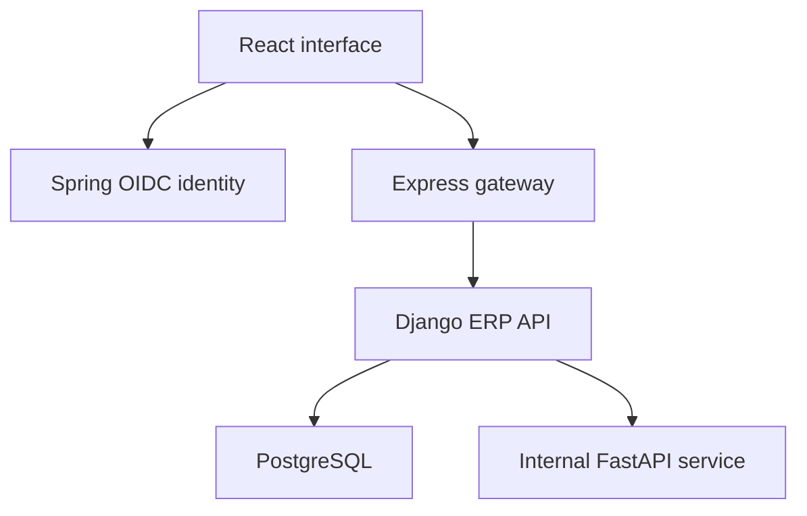

# StockPilot

**Inventory, purchasing, sales and finance in one multilingual workspace.**

StockPilot is an operational ERP application for organizations that need to track
products, warehouse stock, orders, invoices and payments. It combines a React
interface with a transactional Django API, a separate OIDC identity service,
and internal OCR and forecasting services.

The interface supports **English, French and Arabic**, including Arabic
right-to-left layout. Each organization has its own records, role assignments,
appearance settings and plugin installations.

## Features

| Module | Capabilities |
|---|---|
| Catalog | Products, categories, units, tax rates and customer/supplier records |
| Inventory | Stock balances, append-only movements, adjustments, transfers, reservations and reconciliation |
| Purchasing | Draft orders, submission, approval, partial receipts and event history |
| Sales | Stock reservation, partial shipment, cancellation and customer returns |
| Finance | Customer/supplier invoices, payment allocation, expenses and currency-separated summaries |
| Document OCR | Private PNG/JPEG/PDF uploads, extracted fields and human-reviewed supplier invoice drafts |
| Recommendations | Demand forecasts, replenishment suggestions, anomaly checks and recorded human decisions |
| Extensions | Reviewed JSON plugins, dependency validation, configuration, updates and rollback history |
| Workspace | Organization switching, role-based access, languages and optional design settings |

Financial reporting supports DZD, EUR and USD separately. OCR approval creates a
draft; it does not automatically post invoices. Recommendations do not
place orders. Plugins configure reviewed read-only behaviors rather than execute
uploaded third-party code.

## Architecture



| Component | Main technologies | Directory |
|---|---|---|
| Frontend | React, TypeScript, Vite, Material UI, React Query | `apps/web` |
| ERP API | Django, Django REST Framework, exact decimal arithmetic | `services/erp-core` |
| Gateway | Express, JWT verification, WebSocket notifications | `services/api-gateway` |
| Identity | Java 21, Spring Boot, Authorization Code + PKCE | `services/identity` |
| AI assistance | FastAPI, Tesseract, OpenCV, scikit-learn | `services/ai-service` |
| Developer SDK | Python manifest validator, CLI and API client | `sdk/python` |

The gateway handles transport; Django owns business rules and database writes.
Tenant-scoped API requests require an active membership and
`X-Organization-ID`. Both the gateway and ERP independently validate OIDC tokens.

## Quick start with Docker

Requirements: Docker Engine/Desktop with Compose. Windows users can use Docker
Desktop with WSL2. These commands start a local development environment.

```bash
cp .env.example .env
# Fresh, disposable demonstration only:
SEED_DEMO=true docker compose up --build
```

| Service | Local address |
|---|---|
| Application | http://localhost:5173 |
| Identity | http://localhost:9000 |
| API gateway | http://localhost:3000/api/v1 |

On a deliberately seeded demo, sign in using
`admin@stockpilot.local` / `Admin123!`. Use fictional data only.

For an existing installation, preserve configuration and backups, keep the same
Compose project name and volumes, and start with seeding disabled:

```bash
SEED_DEMO=false docker compose up --build
```

Do not use `docker compose down -v` when retaining data. Database records,
private uploaded documents and signing keys live in persistent volumes.
Migration filenames are retained for upgrade compatibility.

After changing accounts, passwords or roles, refresh the private identity snapshot:

```bash
docker compose run --rm identity-bootstrap
docker compose restart identity
```

## Local development

Requirements: Python 3.12 or 3.13, uv, Node.js 24, pnpm 11, Java 21 and Maven.
OCR additionally needs Tesseract with English/French language data and Poppler.

```bash
uv --project services/erp-core sync --frozen
uv --project services/ai-service sync --frozen
pnpm install --frozen-lockfile
npm --prefix services/api-gateway ci --ignore-scripts
```

For an isolated frontend/API development session, Django defaults to local JWT
authentication and SQLite. In separate terminals:

```bash
uv --project services/erp-core run python services/erp-core/manage.py migrate
uv --project services/erp-core run python services/erp-core/manage.py seed_finance_demo
uv --project services/erp-core run python services/erp-core/manage.py runserver
pnpm dev:web
```

The frontend defaults to `http://localhost:8000/api/v1` outside Compose.
An internal AI URL and matching `AI_SERVICE_TOKEN` are needed to run live OCR or
forecast requests. Use Docker for the integrated OIDC/gateway environment.

## Tests and verification

```bash
uv --project services/erp-core run pytest services/erp-core
uv --project services/erp-core run ruff check services/erp-core
uv --project services/erp-core run python services/erp-core/manage.py check
uv --project services/erp-core run python services/erp-core/manage.py makemigrations --check --dry-run
pnpm lint:web
pnpm test:web
pnpm build:web
npm --prefix services/api-gateway test
uv --project services/ai-service run pytest services/ai-service
mvn -B -f services/identity/pom.xml verify
```

See [verification evidence](docs/VERIFICATION.md) for actual results and remaining
checks. PostgreSQL is required for row-lock concurrency tests; SQLite does not
establish concurrent correctness. Strict mypy is configured but is not yet clean;
that debt is reported rather than suppressed.

## Extension development

```bash
python -m pip install ./sdk/python
stockpilot-plugin init my-stock-alert
stockpilot-plugin validate manifest.json
stockpilot-plugin build manifest.json --summary "Low-stock alert for our warehouses"
```

An organization administrator submits the package in Marketplace. A trusted
platform reviewer approves or rejects it before installation. Supported hooks:
`inventory.low_stock` and `dashboard.notice`. See
[Marketplace and SDK](docs/MARKETPLACE_AND_SDK.md) and
[plugin contracts](docs/PLUGIN_DEVELOPMENT.md).

## Project status and boundaries

This repository is a development application and portfolio demonstration.
Full deployment readiness depends on the target environment and verification.
Default Compose credentials and HTTP URLs are for localhost only.

- Forecasting uses a seven-day moving average; it does not model seasonality or open purchase orders.
- OCR supports English/French recognition; Arabic interface support does not imply Arabic OCR.
- Order-backed billing uses whole-order invoices, not partial-shipment invoicing.
- Finance summaries are operational reporting, not statutory accounting or a general ledger.
- Identity sessions and gateway rate limits are single-instance; scaling requires additional infrastructure.
- Coarse organization locks deliberately protect financial and inventory command consistency.
- Bundled manifests are cached immutable deployment assets; deploy a new release to change them.
- Notification hints use shared authenticated polling with an idle delay of up to 30 seconds, not durable event delivery.

## Documentation

- [Architecture and business rules](docs/ARCHITECTURE.md)
- [Languages and appearance](docs/LANGUAGE_AND_DESIGN.md)
- [Marketplace and SDK](docs/MARKETPLACE_AND_SDK.md)
- [Changes and verification](docs/REVISION_REVIEW.md)
- [Demonstration guide](docs/DEMO.md)
- [Contributing](CONTRIBUTING.md) and [security configuration](SECURITY.md)

No software license has been selected in this package. Choose a license before
advertising the repository as open source or granting reuse rights.
